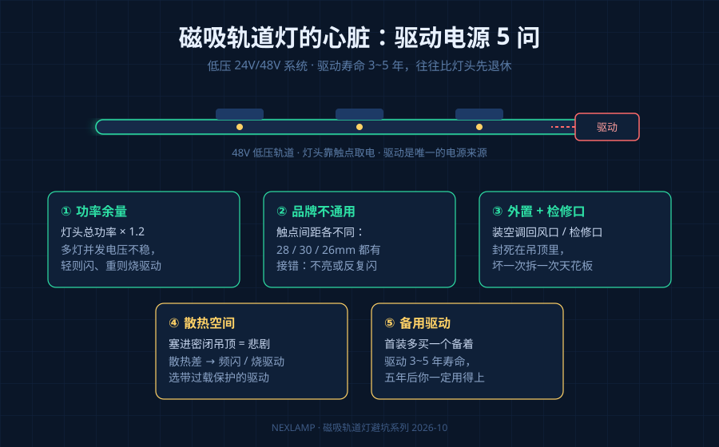
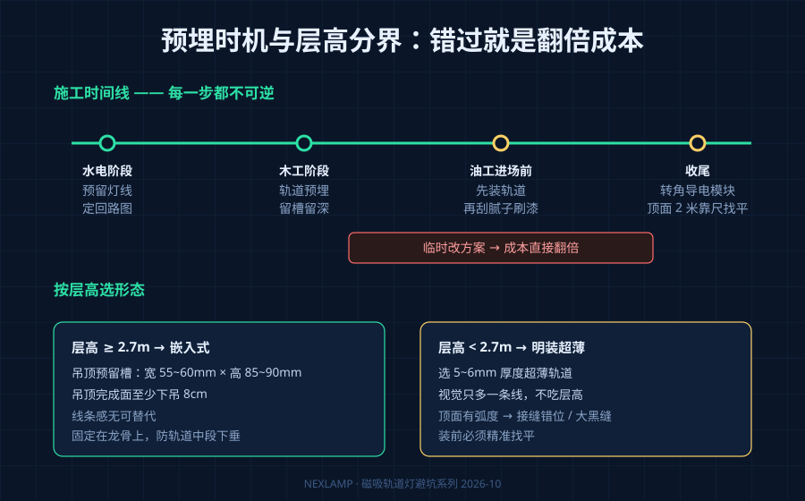
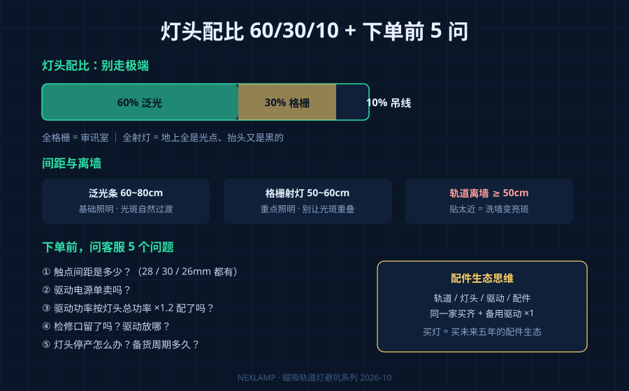

## 引言

磁吸轨道灯这几年稳坐无主灯品类的顶流。2026 香港秋灯展 10 月 27-30 日开幕，无主灯、磁吸轨道、氛围照明依然是本届的趋势重点——而无主灯设计已经占到新建住宅装修 60% 以上的份额。

但落地效果两极分化严重：同一套设计图，有人装出画廊感，有人装出"线乱如麻的灾难现场"。干了二十年灯具，我可以说一句实话：翻车几乎都栽在三件事上——驱动、预埋、散热。

## 驱动，是低压系统的"心脏"

先说一个最基本但很多人不知道的事：磁吸轨道灯是低压产品，系统电压是 24V 或 48V，必须配一个驱动电源，也就是大家口中的"变压器"。家装一律选 48V 低压，别碰 220V 高压轨道——高压轨道的灯头取下来，手指一摸可能触电，家里有小孩的尤其要小心。亮度跟电压没关系，看的是灯珠。

驱动这个不起眼的铁盒子，恰恰是整个系统最容易出问题的地方。五件事你必须搞清楚：

1. **寿命有限。** 驱动的一般寿命是 3-5 年，比灯头短得多。灯亮着不代表系统健康，驱动才是那个先走的人。
2. **功率要留余量。** 灯头总功率乘以 1.2，才是你需要的驱动功率。不留余量，多个灯头同时点亮时电压不稳，灯会闪，严重了直接烧驱动。
3. **品牌不通用。** 雷士触点间距 28mm，欧普 30mm，Yeelight 26mm，电流参数也各不相同。轨道和驱动混搭，轻则接触不良反复闪，重则干脆不亮。
4. **要外置、要留检修口。** 嵌入式电源藏进吊顶又不留检修口，是装修圈最经典的自杀式操作——坏了只能拆天花板。
5. **散热决定寿命。** 驱动闷在不通风的吊顶里，散热不好，轻则频闪，重则烧掉。

给你一张务实清单：

| 事项 | 正确做法 | 错误做法的代价 |
|------|----------|----------------|
| 功率余量 | 灯头总功率 ×1.2 选驱动 | 多灯并发电压不稳，灯闪甚至烧驱动 |
| 品牌匹配 | 轨道、驱动、灯头同一家买齐 | 触点间距对不上，接触不良反复闪 |
| 安装位置 | 电源外置，放空调回风口或检修口附近 | 藏死吊顶，坏了拆天花板 |
| 散热 | 通风、留空间 | 频闪，缩短 3-5 年寿命 |
| 备用 | 首装多买一个备用驱动 | 五年后驱动停产，满屋找货 |

最后一条不是吓你。首装多花几十块钱买个备用驱动，五年后你一定会感谢当天的自己。

## 预埋与层高：时机错了，成本翻倍

轨道这东西没法"后期加装"，必须木工阶段预埋，水电阶段就得预留灯线，油工进场前先装轨道再刮腻子刷漆。装修到一半临时想加磁吸轨道？成本直接翻倍。

嵌入式轨道要在吊顶预留 55-60mm 宽、85-90mm 高的槽位，吊顶完成面至少下吊 8cm。所以层高是个硬门槛：低于 2.7 米的户型，别硬做嵌入式，选明装超薄轨道（5-6mm 厚度），高级感还在，层高不牺牲。

明装轨道也别高兴太早——它对顶面平整度要求很高。轨道是硬直的，顶面有一点弧度，接缝就错位，或者裂出一条大黑缝。安装前拿 2 米靠尺找平；石膏板吊顶一定要把轨道固定在龙骨上，不然时间一长轨道中间下垂。

还有个容易被忽略的细节：转角必须买专门的"转角导电模块"，不然电流穿不过弯道，拐角那一段就是摆设。电源线建议留在轨道一端，别藏在中间。

## 灯头配比：60/30/10，别走极端

很多人一进店就被销售带偏，全屋上格栅灯。光束太集中，客厅秒变审讯室。反过来全装射灯，地上全是光点，一抬头又是黑的。

业内比较稳的配比是 **60% 泛光 + 30% 格栅 + 10% 吊线**。间距上，泛光条 60-80cm 一个，格栅射灯 50-60cm 一个。轨道离墙至少 50cm，不然洗墙效果根本出不来——很多业主抱怨"洗墙跟没洗一样"，其实是轨道贴墙太近。

## 品牌锁死：买的是轨道，签的是"卖身契"

这一点很多人是三年后才明白的。各家轨道的接口、触点间距、供电参数都不一样，今天买了雷士轨道，三年后想加灯头，只能继续买雷士。要是赶上灯头停产，就只能拆了轨道重来。

所以下单前把轨道、灯头、驱动、配件在同一家买齐，顺手按 1.2 倍功率买好驱动。这是买灯，也是买一个未来五年的配件生态。

## 下单前，问客服这 5 个问题

| 问题 | 为什么要问 |
|------|-----------|
| 触点间距是多少？ | 28mm 还是 30mm，直接决定灯头能不能插进你的轨道 |
| 驱动电源单卖吗？ | 捆绑套装坏了可能整套换，单卖才有检修余地 |
| 驱动功率留余量了吗？ | 确认按灯头总功率 ×1.2 配，别按刚好配 |
| 检修口留了吗？ | 电源外置或靠近检修口，五年后不用拆吊顶 |
| 灯头停产怎么办？ | 问清备货周期，顺便把备用驱动一起买了 |

## 常见问题

### 48V 和 220V 轨道怎么选？

家装无脑选 48V 低压。220V 高压轨道灯头取下时可能触电，有小孩的家庭尤其别碰。亮度看灯珠，跟电压无关。

### 驱动坏了必须拆吊顶吗？

不一定。如果当初把驱动外置在空调回风口或预留检修口附近，换个驱动十分钟的事。藏死在吊顶里的，那就只能开板了。

### 磁吸轨道灯是智商税吗？

不是，但前提是装对。回路划分清楚、驱动留足余量、预埋时机踩准，它的灵活性和氛围感确实值这个价；随便找个师傅糊上去，才是真的交学费。

如需技术支持或产品选型建议，请联系耐利普科技工程团队：**138-2549-6855**。
