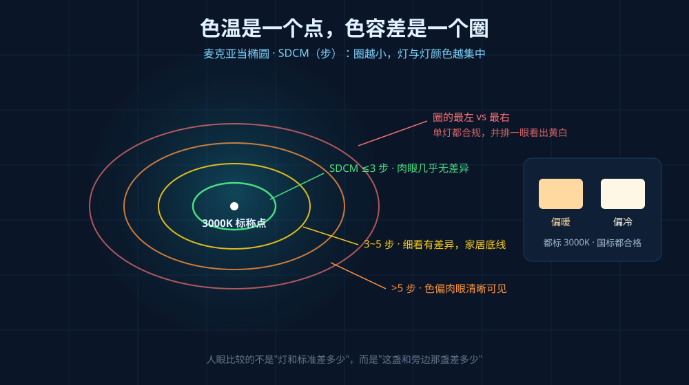
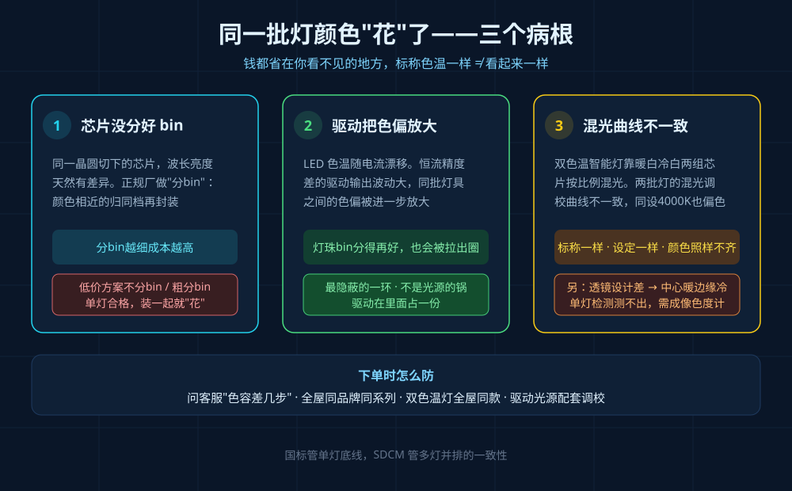
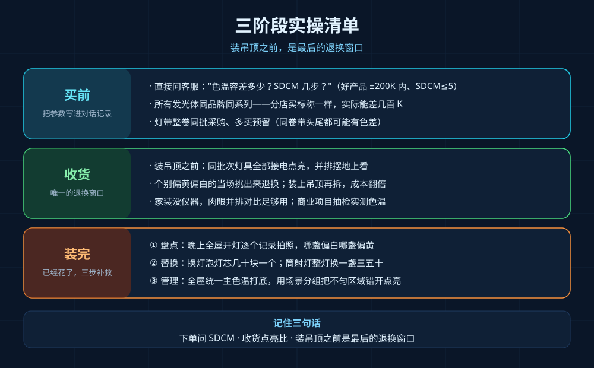

## 引言

一个经典的现场：客厅吊顶一排六盏筒灯，全部标称 3000K，晚上开灯——两盏偏黄、三盏正白、还有一盏泛绿，整面天花板像打了补丁。业主第一反应是"灯坏了"，找商家扯皮，商家拿出检测报告：单灯色温 3000K±150K，完全符合国标。

双方都没说谎，但问题真实存在。干了二十年灯具，我可以直接告诉你答案：**国标管的是单灯色温底线，管不住多灯并排时的一致性——真正决定你家"高级感"的，是一个叫色容差的参数。**

## 色温是一个点，色容差是一个圈

先说概念。色温标称是"一个点"——3000K。但任何量产 LED 都有公差，实际颜色会围绕这个点在色度图上浮动。这个浮动范围，行业里用 SDCM（色匹配标准偏差，源自麦克亚当颜色匹配实验）来衡量，单位是"步"。

打个比方：3000K 是靶心，色容差就是靶纸上允许命中的范围。**这个圈画得越小，灯与灯之间的颜色就越集中。**

关键在于：人眼比较的不是"这盏灯和标准 3000K 差多少"，而是"这盏灯和旁边那盏灯差多少"。两盏灯各自都在国标范围内，但一个落在圈的最左、一个落在圈的最右，并排一装，肉眼立刻能看出一黄一白。

行业通行的分档是：

| SDCM 档位 | 实际观感 | 适用场景 |
|-----------|----------|----------|
| ≤3 步 | 肉眼基本无差异 | 商业展示、射灯筒灯近距混排、追求质感家装 |
| 3~5 步 | 并排细看有轻微差异 | 普通家居可接受的底线 |
| >5 步 | 色偏肉眼清晰可见 | 一排灯像调色盘，应直接拒收 |

## 三个病根：钱都省在你看不见的地方

同一批灯颜色"花"了，病根通常在三个环节。

**第一，芯片没分好 bin。** 同一片晶圆切下来的芯片，波长和亮度天然有差异。正规厂家会做"分 bin"——把颜色相近的芯片归到同一档再封装。分得越细，成本越高，因为可用芯片比例下降，剩下的要降级处理。低价方案往往不分 bin 或只做粗分：出厂单灯测都在范围内，装到一起就"花"了。

**第二，驱动电源把色偏放大。** 这是我最想强调的一环，因为它最隐蔽。LED 的色温会随电流漂移，恒流精度差的驱动，输出电流波动大，同一批灯具之间的色偏会被进一步放大——灯珠分 bin 分得好好的，被一颗烂驱动拉出了圈子。所以色温一致性不只是光源的锅，**驱动也在里面占一份**。

**第三，双色温混光曲线不一致。** 智能双色温灯靠暖白、冷白两组芯片按比例混光。如果两批灯的混光调校曲线不一致，同时调到 4000K，一个偏暖一个偏冷——标称一样、当前设定一样，颜色照样对不上。

此外还有第四种情况：透镜或反光杯设计缺陷导致单灯内部中心光斑偏暖、边缘光斑偏冷，这种问题单灯色温检测测不出来，需要成像色度计才能拍出来。

| 病根 | 出在谁身上 | 下单时怎么防 |
|------|-----------|--------------|
| 芯片粗分 bin | 光源厂 | 问客服"色容差多少步"，答不上来的慎买 |
| 驱动恒流精度差 | 电源厂 | 全屋灯尽量同品牌同系列，驱动和光源配套调校 |
| 混光曲线不一致 | 整灯厂 | 双色温灯全屋同款，别两个牌子混着调 |
| 透镜中心/边缘色差 | 整灯厂 | 大牌透镜方案成熟，杂牌重灾区 |

## 三阶段实操：买前、收货、装完

**买前——把色容差写进对话记录。** 下单前直接问客服："色温容差多少？SDCM 几步？"正规品牌能给出明确数据（好产品 ±200K 以内、SDCM≤5）；支支吾吾说"哪能完全一样"的，基本就是没分 bin。所有发光体尽量同品牌同系列——磁吸轨道、筒灯、射灯、灯带分别在不同店买，标称一样实际能差出几百 K，这是无主灯翻车的头号原因。灯带尤其要整卷同批采购，同一卷带头尾都可能有色差，务必多买预留。

**收货——装吊顶之前，先点亮并排比。** 这是唯一来得及退换的窗口。把同批次灯具全部接电点亮，并排摆在地上看：个别偏黄偏白的当场挑出来退换。一旦装上吊顶，拆换的成本和心态完全是另一回事。商业项目会抽检实测色温，家装没有仪器，肉眼并排对比足够用。

**装完——已经花了，三步补救。** 第一步盘点：晚上全屋开灯逐个记录拍照，哪盏偏白哪盏偏黄；第二步替换：可换光源的直接换灯泡灯芯（几十块一个），筒射灯整灯替换一盏三五十；第三步管理：全屋统一一个主色温打底，用场景分组把混不匀的区域"错开点亮"，混乱感能压下去一半。预算紧张就优先统一客餐厅走廊这些天天用的公共区域，卧室门一关看不见。

## 常见问题

**Q：高显指（Ra 98）的灯是不是色容差也小？**
不是一回事。显指管"物体颜色还原准不准"，色容差管"灯与灯颜色一不一致"，是两个独立维度。高 Ra 掩盖不了高 SDCM，采购时两个都要问。

**Q：智能灯不是可以调色温吗，颜色不就统一了？**
调色温调的是"各自的目标值"，调不了"各自基准的偏差"。两个基准偏得远的灯，设成同一个 4000K 也不一样色。智能灯的正确用法是全屋同款同批次，再统一设定。

**Q：买大品牌是不是就稳了？**
大品牌的分 bin 和品控确实好一个量级，但跨系列、跨年份批次仍可能有色差。认品牌之外，还要认"同系列同批次"，收货点亮对比这一步不能省。

## 写在最后

无主灯的高级感，一半在设计，一半在一致性。色容差这个参数商家不主动提、国标单灯报告看不见，但它就是"看着贵"和"看着廉价"之间那道很薄的线。记住三句：**下单问 SDCM，收货点亮比，装吊顶之前是最后的退换窗口。**
