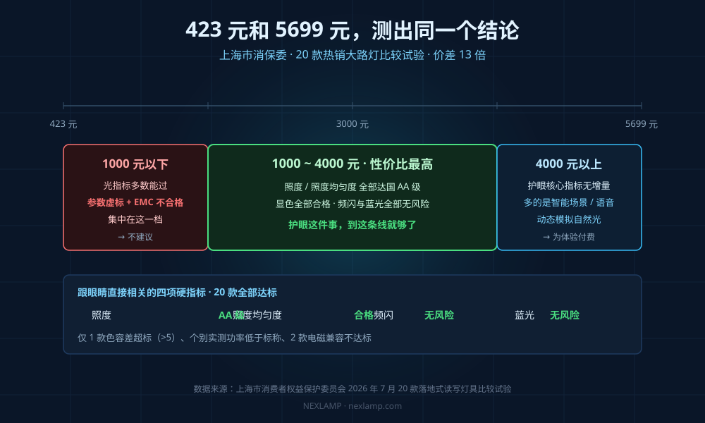
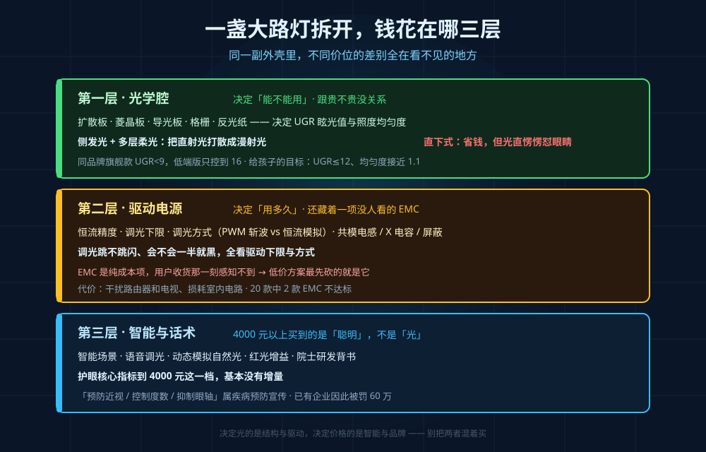
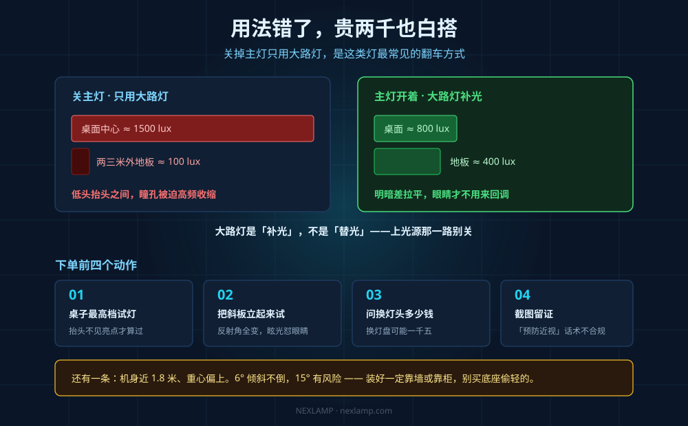

## 引言

今年双11前，大路灯成了家长群里最贵的一件"文具"。上海市消保委今年 7 月的 20 款热销大路灯比较试验，最便宜 423.3 元，最贵 5699.3 元，价差 13 倍，结果挺反常——**照度、照度均匀度 20 款全部达国 AA 级，显色全部合格，频闪和蓝光 20 款全部无风险。**

423 块的和 5699 块的，在最影响眼睛的四项上测出同一个结论。多出来的五千块买了什么？把灯从物料上拆开，钱花在哪三层很清楚。

## 第一层：光学腔决定"能不能用"，跟贵不贵没关系

大路灯上下两个发光面分工不同：上光源打天花板靠漫反射提亮屋子，下光源照书桌。真正决定"刺不刺眼、桌面匀不匀"的是**光学腔**——扩散板、菱晶板、导光板这些不起眼的东西。

行业里公开、导购不会主动说的是：**同品牌高端款和低端款，差别常常就在这一层。** 中照网实测拆解过某品牌，旗舰款眩光值 UGR 做到 9 以下，低端版只控到 16，价格却比杂牌同档还贵。

UGR 是统一眩光值，≤13 时多数人眩光感较低，给孩子用最好压到 12 以内。**这个数字不是花钱买灯珠买来的，是靠腔体几何做出来的：** 侧发光加多层柔光板把直射光打散成漫射光，直下式省钱，光却直愣愣往眼睛里怼。照度均匀度同理，好的能到 1.1 上下，差的桌面中间一个亮斑、四角发暗。

判断方法很简单：**坐进书写位抬头，能不能直接看到发光面的亮点。** 看不到、只有柔和反光就过关。

## 第二层：驱动决定"用多久"，还藏着一项没人看的 EMC

驱动干三件事：恒流、调光、关住电磁干扰。

前两件你能感觉到——**调光跳不跳闪、会不会一半就黑，全看驱动的下限和方式**。便宜方案用 PWM 斩波，看着不闪，手机一扫就是黑杠；好的走恒流加模拟调光。

第三件你感觉不到，直到它出问题——**电磁兼容，EMC。** 消保委报告里 20 款有 2 款栽在这上面：标称"瑞界"的 QG2358 90W 灯具，骚扰电压、辐射骚扰、谐波电流三项不达标；标称"好视力"的 F9 100W 落地灯，辐射骚扰不达标。分档结论更直白：**参数虚标和 EMC 不合格，主要出在 1000 元以下这一档。**

这类灯会干扰路由器、电视，长期用还损耗室内电路——你以为是 WiFi 卡，其实是灯在撒噪声。从工厂角度 EMC 是纯成本项：共模电感、X 电容、屏蔽、认证，每项都要钱，用户收货那一刻却感知不到，**所以低价方案最先砍的就是它。** 

这一层还有结构。机身近 1.8 米、重心偏上，消保委倾斜测试里 6° 20 款都没倒，到 15° 就有倾倒风险。**别买底座偷轻的，装好一定靠墙或靠柜。**

## 第三层：4000 元以上，买的是"聪明"不是"光"

| 价位 | 实测表现 | 判断 |
|------|----------|------|
| 1000 元以下 | 基本指标多数能过，虚标、EMC 不合格集中在这一档 | 不建议，风险在看不见的地方 |
| 1000~4000 元 | 照度、显色、频闪、蓝光全部够用，性价比最高 | 家用主战场，钱花得值 |
| 4000 元以上 | 护眼核心指标没有增量，多的是智能场景、语音调光、动态模拟自然光 | 为体验付费，不为护眼付费 |

一句话：**为"护眼"多花的钱，到 4000 元这一档基本就没有增量了。**

再往上还有一类溢价是这个品类特有的——功效话术。《法治日报》8 月调查发现，不少详情页直接写"预防近视、控制度数上涨、抑制眼轴变长"；今年 1 月，一家护眼灯具企业就因广告含疾病预防内容被罚 60 万。消保委的表述很明确：大路灯不具备逆转或治愈近视的功能。北京一位三甲医院眼科医生更直接——低龄孩子每天高强度近距离用眼四到六小时，**顶配灯具也抵消不了这个损伤**。至于"红光增益""院士研发"，有款 1499 元的灯打着"中科院士研发"旗号，后来被扒出院士只是挂了名。

## 比灯更贵的是用法

很多人买完第一件事就是把主灯关了，觉得钱都花了何必再开顶灯，结果正好反了：只用大路灯，桌面照度可能到 1500 lux，两三米外的地板只有 100 lux，孩子低头抬头之间瞳孔高频收缩，比均匀偏暗更累。

**正确用法是"补光"不是"替光"：主灯开着，大路灯把桌面那一片做匀**，上光源那一路别关，它的意义就是拉平整屋明暗差。这条不花钱，比换个贵两千的型号管用。

## 下单前做五件事

1. **在桌子最高档试灯**："抬头不见亮点"要在最高档做，桌子会升降，顺带看桌面反光。
2. **把斜板立起来试**：板子一抬反射角全变，眩光正好怼进眼睛。
3. **问过保换灯头多少钱**：有些灯整机便宜，换灯盘要一千五，上门人工一次两三百。
4. **截图留证**：凡出现"预防近视""控制度数"的，存好，这类宣传本身就不合规。

## 三个常问的问题

**Q：那买 1000 块的就行，贵的都是智商税？**
A：不是。1000 元以下才是风险区。1000~4000 元挑 UGR≤12、均匀度接近 1、上下光源能独立调、Ra 95 以上的，钱花得明白。

**Q：全光谱、紫光激发有用吗？**
A：有用，但别当第一顺位。收益远小于照度均匀度和眩光控制——后两项靠光学腔结构，跟灯珠贵不贵关系不大。

**Q：孩子已经近视了，换灯有用吗？**
A：灯不能治病，只是把局部光环境做舒服、减少视疲劳。真正有效的还是户外活动和用眼时长。

最后一句实话：**光指标是门槛，不是卖点。** 跨过门槛之后，多花的每一分钱都要问清楚它买的是哪一层。
