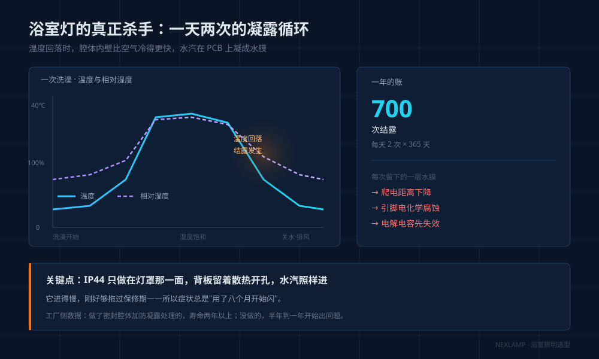
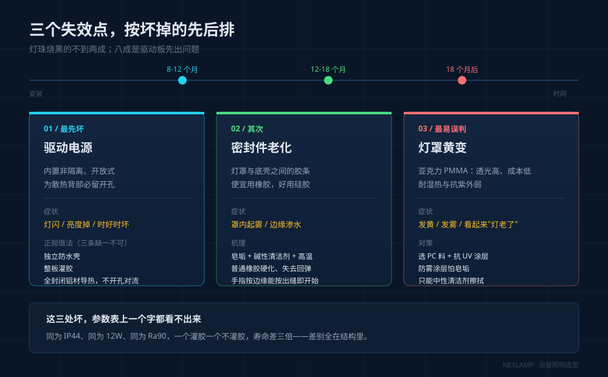
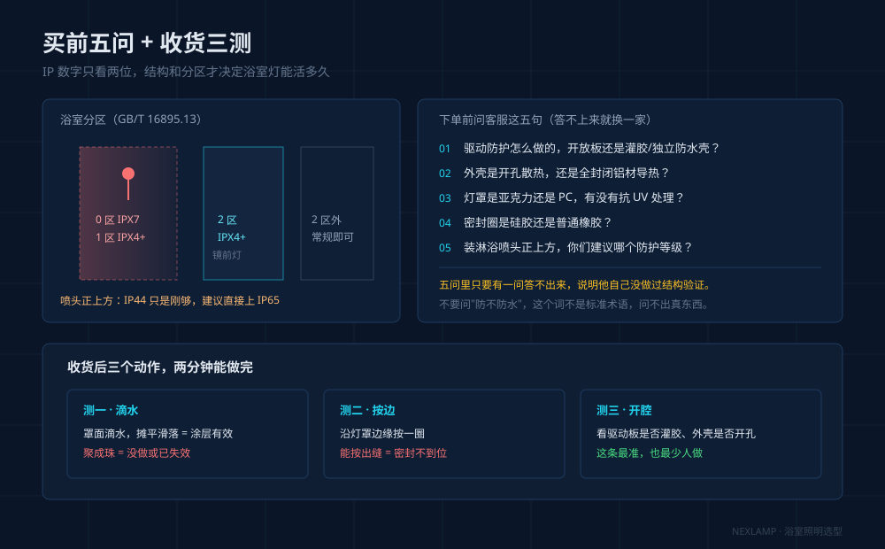

## 引言

前阵子给客户换浴室灯。装好八个月，灯还亮，但一开就闪。拆开看驱动板，上面一圈白色结晶——不是烧黑的痕，是水汽进去、蒸发后留下的盐类残留。这盏灯标题写着"防水防雾"，参数栏印着 IP44。

干了二十年灯具，浴室灯的规律很稳定：**坏的灯里灯珠烧黑的不到两成，剩下八成都是驱动板先出问题**，且集中在装完 8 到 18 个月。不是运气，是结构决定的。

## 一、杀手不是"潮"，是每天两次的凝露

浴室灯不是被潮气泡坏的，是被**反复结露**伤的。

洗一次澡，浴室从 18℃ 升到 35℃ 以上、湿度接近饱和，灯具腔体里的空气同样被加热。关水开排风，温度回落，腔体内壁降得比空气快，水汽就在 PCB 和电容壳上凝成水珠。一天两次，一年七百次。

伤的是每次凝露留在电路板上的薄水膜——它吃掉爬电距离、加速引脚电化学腐蚀。**IP44 如果只做在灯罩那一面，背板还留着散热开孔，水汽照样进，只是慢一点，刚好够拖过保修期。**

## 二、三个失效点，按坏的先后排

**第一个：驱动电源。** 低价浴室灯的驱动是内置非隔离、开放式的，为散热背部一定留开孔。水汽从孔进去先腐蚀电解电容引脚，症状是灯闪、亮度掉、偶尔点不亮过会儿又好。正规做法三条一起：驱动独立做防水壳、整板**灌胶**、外壳用全封闭铝材导热而不是靠开孔对流。少一条，寿命掉一档。

**第二个：密封件。** 灯罩和底壳之间那圈胶条，便宜用普通橡胶，好用硅胶。浴室里除水还有皂垢和清洁剂，普通橡胶在高温碱性环境下会硬化失弹，一年左右开始渗。手指沿灯罩边缘按一圈，能按出缝的就是开始老化。

**第三个：灯罩。** 亚克力（PMMA）透光高、成本低，是浴室灯最常用罩材，但耐湿热和抗紫外弱，长期高湿加清洁剂会黄变发雾；PC 加抗 UV 涂层耐久得多，代价是成本高一档。至于"防雾涂层"，是罩内表面做亲水处理让水珠摊平，抵不过皂垢。

## 三、IP 数字管什么，IP44 能不能装淋浴区

常见误解是把 IP44 当"防水"。它是两个数字：**第一位管固体**，4 = 挡住 1mm 以上异物；**第二位管水**，4 = 承受各方向溅水——是"溅"，不是"喷"（IPX5），更不是"浸"（IPX7）。

所以 IP44 挡得住溅过来的水，挡不住从开孔灌进去的水汽，也挡不住饱和湿度下的渗透。很多标 IP44 的灯照样坏，原因就在这。

真正该看的是**分区**。按 GB/T 16895.13（等同 IEC 60364-7-701）：

| 区域 | 范围 | 防护要求 | 常见做法 |
|---|---|---|---|
| 0 区 | 浴缸、淋浴盆内部 | IPX7 | 一般不放灯 |
| 1 区 | 浴缸/淋浴盆上方至 2.25m；无盆淋浴以喷头为中心半径 1.2m | 不低于 IPX4（公共洗浴 IPX5） | 防水筒灯、专用浴室吸顶灯 |
| 2 区 | 1 区外扩 0.6m | 不低于 IPX4 | 镜前灯、浴室主灯 |
| 2 区外 | 其余位置 | 常规室内灯具 | 普通吸顶灯 |

**镜前灯在 2 区，IP44 是底线不是加分项；装在淋浴喷头正上方（1 区），IP44 只是刚够，建议直接上 IP65**。

## 四、参数怎么定

| | 浴室主灯 | 镜前灯 | 淋浴区筒灯 |
|---|---|---|---|
| 防护等级 | IP44 起，带罩密封 | IP44 起，背面全封闭 | IP65 |
| 色温 | 3000–4000K | 4000K 中性光 | 4000K |
| 显色指数 | Ra≥80 | **Ra≥90** | Ra≥80 |
| 功率参考 | 8–15W（4–6㎡） | 8–12W | 5–7W |
| 光源形式 | 优先可换光源 | 优先可换光源 | 一体式可接受 |

镜前灯两个装法硬指标：**灯长至少覆盖镜宽 70%**，否则脸颊两侧有暗区；顶装时灯底沿距地约 1.9m，太低会在镜里看到倒影，太高会在眼下压阴影。

一体式还是可换光源：一体式好看、防水好做，但坏一处换整灯；能换灯泡的（E27、GU10）长期成本更低。这是维修路径问题。

## 五、买前五问，收货三测

**问客服这五句**，答不上来就换一家：① 驱动防护怎么做的，内置开放板还是灌胶/独立防水壳？② 外壳是开孔散热还是全封闭铝材导热？③ 灯罩是亚克力还是 PC，有没有抗 UV 处理？④ 密封圈硅胶还是普通橡胶？⑤ 装淋浴喷头正上方，你们建议哪个防护等级？

**收货三测**：罩面滴水，摊平是涂层有效，聚成珠说明没做或已失效；沿灯罩边缘按一圈，按出缝就是密封不到位；开接线腔看驱动有没有灌胶。

## 六、智能灯进浴室

**人在感应要能关。** PIR 靠温度变化判断，浴室温度阶变最剧烈；24G 雷达怕水汽和镜面反射。买前确认"感应可单独关闭"、关闭后手动开关仍有效。**WiFi 版想清楚**：瓷砖墙、铝扣板吊顶、金属镜柜，2.4G 衰减明显，要么网关放中继位，要么直接用 Zigbee、Thread 这类有网关兜底的方案。

## 两个常问的问题

**Q：标 IP44，为什么还是坏了？**
A：IP44 第二位是"防溅水"，管外部溅水，不承诺饱和湿度下内部不结露。能不能活下来，看驱动有没有灌胶、腔体是否密封、外壳靠什么散热——这三个问题 IP 数字答不了。

**Q：已经装了普通吸顶灯，能补救吗？**
A：按顺序：先看驱动位置，裸露在吊顶里又没防水壳的，换驱动或加防水盒；再处理密封，换硅胶条、背部开孔用防水透气膜封住；最后才考虑换灯罩。

---

同为 IP44，一个灌胶驱动加全封闭铝壳，一个开放板加开孔散热，参数栏看不出区别，寿命差三倍。浴室是家里唯一同时具备高温、高湿、温度阶变和清洁剂的空间。
