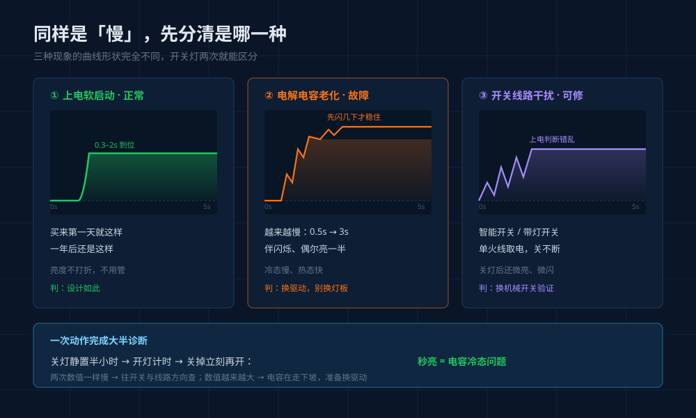
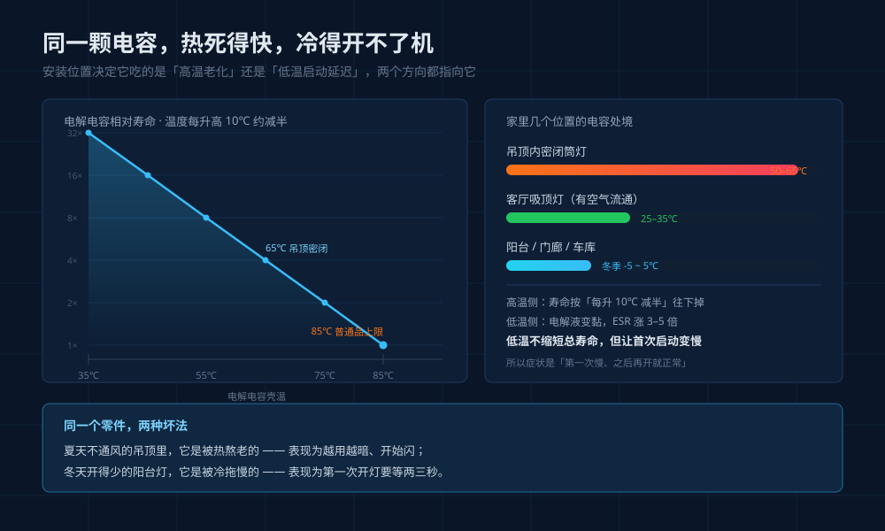

## 引言

上周客户打电话，说老家阳台的灯"坏了"——晚上一开要等两三秒才亮，问换灯板多少钱。

我让他做个动作：关掉，立刻再开。秒亮。

那就不是灯坏了。这个"关久了慢、关一下再开就快"的顺序，本身已完成大半诊断：**问题在驱动的启动环节，跟灯珠无关，换灯板白花钱**。入冬后这类电话会集中来一波，不是巧合。

## 一、先分清三种"慢"，只有一种是病

**软启动，正常。** 正规驱动都做上电软启动，用来压涌流、护灯珠。特征是 0.3–2 秒亮起，**买来第一天就这样，一年后还这样**，亮度不打折。

**电容老化，故障。** 特征是**越来越慢**：先零点几秒，一年后两三秒，再往后变成先闪几下才稳、偶尔亮一半、最后不亮。这是家用 LED 最常见的失效路径。

**开关或线路捣乱。** 智能开关、带指示灯的墙壁开关、单火线取电开关，关闭时仍有微弱电流，让驱动上电判断错乱，表现为延迟、微闪、关不干净。

区分只需一个动作：**换普通机械开关试一次**。现象消失是第三种，还在且越来越重是第二种。

## 二、为什么偏偏是电容

灯珠不怕冷，温度低一点光效甚至略好。整盏灯里最怕冷、也最先老的，是驱动板上那颗铝电解电容。

电容靠电解液传导离子，常温下黏度低、离子跑得快，等效串联电阻（ESR）小，上电能迅速充到工作电压。温度一降，电解液变黏，**ESR 成倍上升**——零下二十度时涨到常温的三到五倍，是行业常见数据。

ESR 一高，上电充电就慢，输出爬到芯片启动阈值要多花时间，这就是那两三秒。等电路跑起来、自身发热把板子烘暖，电容恢复活性，一切正常。**所以症状是"第一次慢、之后正常"，而不是一直慢。**

另一头是热。电解电容有条经验规律：**温度每升 10℃，寿命约减半**。装在密闭筒灯里、夏天吊顶内五十度的位置，老化速度是通风位置的好几倍——这也是同批灯里卫生间先坏、阳台先慢的原因。

## 三、哪些位置的灯先出问题

| 安装位置 | 主要原因 | 典型表现 |
|---|---|---|
| 阳台、门廊、车库、储物间 | 冬季环境温度低 | 入冬后首次开灯延迟 |
| 北方空置房、度假屋 | 长期低温 + 长期断电 | 延迟从几秒发展到不亮 |
| 密闭筒灯、射灯（吊顶内） | 散热差，长期高温老化 | 用两三年后开始闪、延迟 |
| 户外壁灯、庭院灯 | 低温 + 温差 + 水汽 | 冷启动延迟伴偶发不亮 |

规律：**温度越极端、越密闭、开灯越不频繁的位置，电容先撑不住**。常年亮着的灯反而稳，因为板子一直是温的。

## 四、不用仪器，三步自测

**断电量时。** 关灯静置半小时以上再开，掐表；再关掉立刻开一次。**冷态慢、热态快 → 电容问题**。

**换开关。** 临时接到普通机械开关上试。消失是开关漏电流或单火取电干扰，不变就回到电容。

**看驱动。** 断电拆下，看外壳有没有鼓包、变形、发黄，板上电容顶部有没有鼓顶或渗液。**看到鼓包不用再测，直接换**。再看铭牌生产日期，超五年别修。

## 五、换驱动，五个参数必须对上

恒流驱动是"给多少毫安"的电源，参数对不上轻则不亮，重则烧灯板。

| 参数 | 怎么对 | 常见坑 |
|---|---|---|
| 输出电流 | 等于或略小于原标称值 | 只看功率不看电流，买大一号，灯珠过热 |
| 输出电压范围 | 新驱动要覆盖原范围 | 不覆盖，低亮档起不来、闪烁 |
| 输出功率 | 留 10%–20% 余量 | 满载长期跑，电容又早衰 |
| 认证 | 3C（CCC）或 CQC，编号可查 | 无认证驱动是家里最不该省的几十块 |
| 电容耐温 | 优先 105℃，宽温型 -40–105℃ | 只标 85℃ 的，在吊顶里就是短命件 |

另外：能选**灌胶**就选，胶体既绝缘又导热，电容温度低一截。

## 六、买新灯时问这四句

① 驱动是恒流还是恒压，输出多少毫安？② 电解电容 85℃ 还是 105℃？③ 驱动灌胶了吗？④ 驱动独立可换，还是和灯板一体？

前三个决定三年后是"换颗驱动几十块"还是"整灯报废"，第四个决定你有没有得选。一体式好看、防水好做，但坏一处换一盏。

## 三个常问的问题

**Q：延迟两三秒，有安全隐患吗？**
A：单纯延迟没有风险。但若伴随外壳发烫、轻微焦味，或延迟在几周内快速变长，别再观察，断电换驱动——那是电容临近失效，可能连带烧灯板。

**Q：整盏灯换掉是不是更省事？**
A：看灯价。几十块的筒灯、球泡，换整灯省事；几百上千的吸顶灯、磁吸灯，灯珠和结构都还好，为一颗驱动换整灯等于扔了八成成本。前提是买得到参数对得上的驱动。

**Q：智能灯的驱动能随便换吗？**
A：不能。智能驱动带通信模块和调光协议，换普通恒流驱动会失去调光、变色、联网，只能找原厂或同协议同功率的替换件。这也是核心位置别用杂牌智能灯的原因：灯珠不坏，驱动先坏，而驱动买不到。

---

天冷后灯变"迟钝"，多数人第一反应是灯珠老了，其实灯珠最抗冻。真正怕冷的是那颗几毛钱的电解电容——它决定这盏灯是花几十块续命，还是整盏扔掉。
