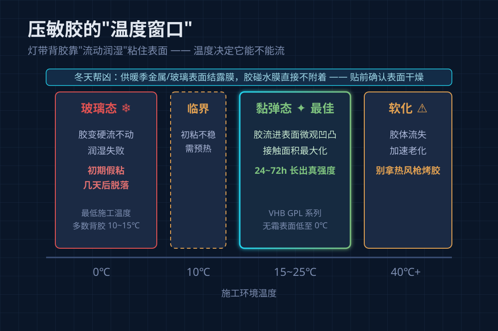
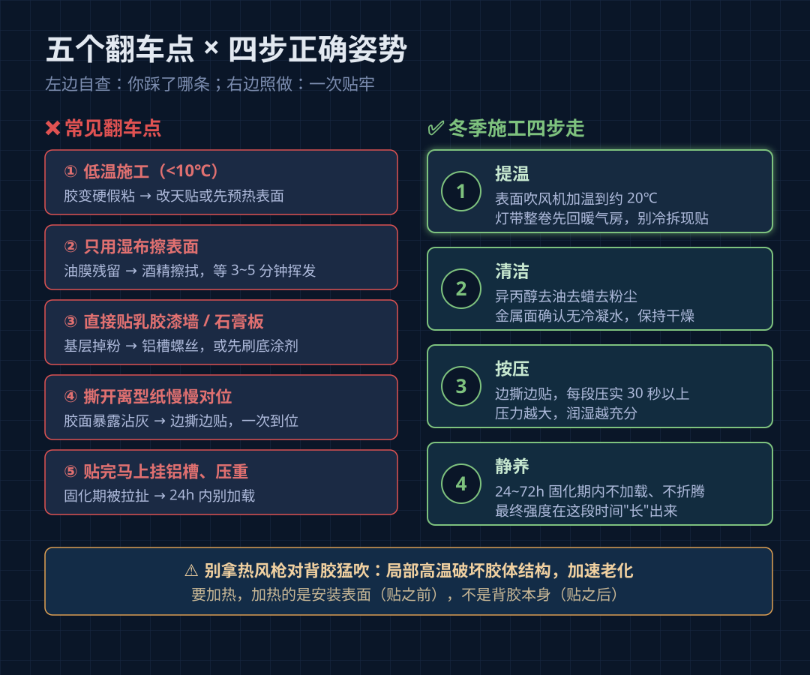
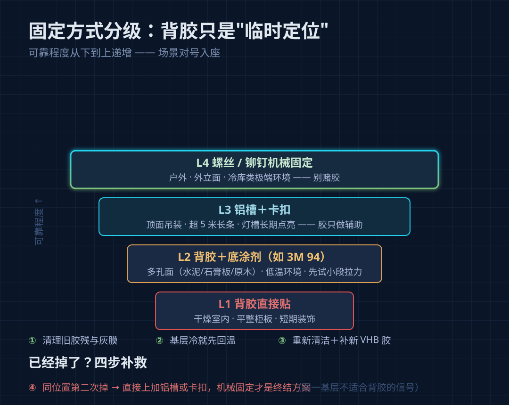

# 天一冷，灯带就开始掉？不是胶不行，是温度没到

每年一入冬，总有客户打电话来问："灯带怎么自己掉下来了？贴的时候明明很牢。"

## 先搞懂：背胶是"压敏胶"，它靠"流"来粘

灯带背上的胶，学名叫压敏胶（PSA），3M VHB 是这类胶里最有名的系列。它的工作原理不是"粘住"，而是**流动**——在压力作用下，胶会慢慢流进安装表面的微观凹凸里，像水漫过沙滩一样把接触面填满。这个过程业内叫"润湿"（wetting）。

润湿对温度极其敏感。市面上绝大多数灯带背胶的最低施工温度在 10~15℃ 左右：温度一低，胶层变硬、接近玻璃态，流不动了。这时你用力把灯带按上去，肉眼看是贴住了，实际上胶和墙面只接触了很小一部分——**初粘是假象，24~72 小时固化期内根本长不出真强度**，再叠加灯带自重和冷热循环，脱落只是时间问题。

还有一个冬天特有的帮凶：**冷凝**。供暖季室温高，金属龙骨、玻璃、瓷砖这些基层表面温度低，空气里的水汽会在上面结一层看不见的露膜。胶碰到水膜，直接没法附着。夏天贴铝槽没事、冬天贴就掉，很多时候就是这个原因。

## 五个最常见的翻车点，对照自查

| 翻车点 | 后果 | 正确做法 |
|---|---|---|
| 低温施工（<10℃） | 胶变硬流不动，初期假粘 | 表面和灯带都预热到 15~25℃ 再贴 |
| 只用湿布擦表面 | 油膜残留，粘接力损失可达八成 | 异丙醇或工业酒精擦拭，等 3~5 分钟完全挥发 |
| 贴在乳胶漆墙/石膏板上 | 基层本身掉粉起皮，胶粘住的是粉 | 改用铝槽螺丝固定，或先刷底涂剂 |
| 撕开离型纸慢慢对位 | 胶面暴露沾灰，越摸越不粘 | 边撕边贴，一次到位 |
| 贴完马上挂铝槽、压重 | 固化期被拉扯，强度长不起来 | 贴完按压 30 秒以上，24 小时内别加载 |

特别提醒一条：很多师傅冬天图省事，直接用热风枪对着背胶猛吹。台湾同行和胶带厂的技术资料都指出，局部高温会破坏胶体结构，反而加速后期老化——**要加热，加热的是安装表面，不是背胶本身**。

## 冬季施工的正确姿势，四步走

1. **提温**：把基层表面用吹风机加温到 20℃ 左右（手背贴上去温热即可），灯带整卷先放在暖气房里回温，不要在冷环境里现拆现贴。
2. **清洁**：异丙醇擦一遍，去油去蜡去粉尘，等它完全挥发。金属表面冬天尤其要确认没有冷凝水，擦完保持干燥。
3. **按压**：边撕离型纸边贴，贴一段压实一段，每段用力按压 30 秒以上。压力越大，润湿越充分。
4. **静养**：贴完 24~72 小时内不要在上面挂任何东西、不要反复开关测试。胶的最终强度是在这段时间里"长"出来的，低温会拖慢这个过程。

## 背胶不是万能的：固定方式要分级

做这行久了想说句实在话：**背胶从来只是"临时定位"，不是结构固定**。下面这张表按可靠程度排了序，对号入座：

| 场景 | 推荐固定方式 |
|---|---|
| 干燥室内、平整柜板、短期装饰 | 背胶直接贴，可选 |
| 多孔面（水泥、石膏板、原木）、低温环境 | 背胶＋底涂剂（如 3M 94），先试小段拉力 |
| 顶面吊装、超 5 米长条、灯槽长期点亮 | 铝槽＋卡扣，胶只负责辅助 |
| 户外、外立面、冷库类极端环境 | 螺丝／铆钉机械固定，别赌胶 |

灯带本身其实不怕冷，LED 在低温下工作反而更舒服——怕冷的只是胶和你的施工流程。环境降不下来温，就别让胶独自扛重力。

## 已经掉了，怎么补救

第一步，把旧胶残和基层上的灰膜清理干净；第二步，确认季节和室温，如果基层还是冷的，先回温再动手；第三步，重新清洁、必要时隔一段补一段新 3M VHB 胶；第四步，如果这已经是第二次掉了，别再按原路重贴——直接上加铝槽或卡扣，机械固定才是终结方案。**同一个位置掉两次，说明这个基层天生不适合背胶。**

## 买灯带时，多问一句"背胶什么型号"

正规灯带厂会在详情页标注背胶：3M 9495LE（对低表面能塑料友好）、9495MP（高表面能金属面）是 SMD 灯带常见配置；COB 灯带多用 VHB 系列。冬季户外或北方无供暖场景，可以直接问有没有**低温施工系列**——3M VHB GPL 系列标称无霜表面 0~5℃ 可贴，3M 56415 棉纸胶带 0℃ 可直接施工。商家答不上背胶型号的，本身就要打个问号。

## 常见问答

**Q：贴的时候挺牢，为什么过几天才掉？**
A：压敏胶的强度在贴完后 24~72 小时内逐步建立。低温下润湿不充分，强度建立不起来，撑过几天自重一拉就开了。

**Q：能不能贴完用吹风机吹一吹加固？**
A：不建议对准背胶吹。高温破坏胶体结构，加速老化。要加热也是贴之前加热基层表面，而不是贴之后烤胶。

**Q：户外圣诞灯饰冬天装，怎么办？**
A：选一天里最暖的时段施工，金属槽体先回温，背胶只做辅助，主固定交给卡扣或螺丝。3M 官方对户外氛围灯给的方案就是 GPL 低温系列＋机械固定组合。

入冬赶工的朋友，把这四步流程和固定分级表存下来。灯带掉一次返工的成本，比贴之前多花十分钟高得多。
