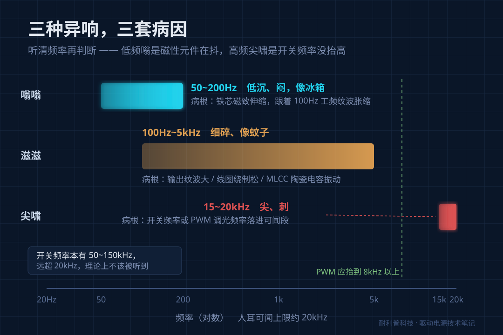
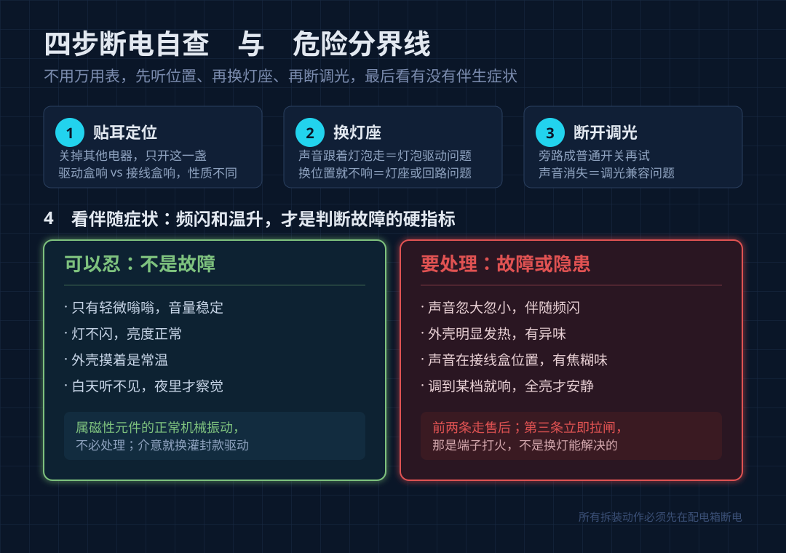

# 灯一开就嗡嗡响、滋滋声，八成不是灯坏了

双11 的灯陆续到了。这两周接到最多的咨询不是"怎么接线"，而是**"灯装上去一直嗡嗡响，是不是坏了，要不要退？"**

先给结论：**LED 灯珠绝对不会响。** 它是块半导体，通电就发光，没有会动的部件。声音全部来自那只看不见的小盒子——**驱动电源**。它内部有变压器、电感、电容，通电时这些东西真的会抖。

所以异响可以按频率分诊：**听清声音，基本就能判断要不要退。**

## 三种声音，三套病因

| 声音 | 频率 | 听感 | 主要来源 |
|---|---|---|---|
| 嗡嗡 | 50~200Hz | 低沉、闷、像冰箱 | 铁芯磁致伸缩，跟着 100Hz 工频纹波抖 |
| 滋滋 | 100Hz~5kHz | 细碎、像蚊子 | 输出纹波大、线圈绕制松、MLCC 电容振动 |
| 尖啸 | 15~20kHz | 尖、刺，年轻人听得见老人听不见 | 开关或 PWM 调光频率落进可闻段 |

## 病根一：铁芯在"呼吸"

驱动里的变压器和电感用铁氧体磁芯，有种特性叫**磁致伸缩**——一进磁场就极其微小地胀缩。开关电源工作在 50~150kHz，远超 20kHz 人耳上限，按理听不见。

问题出在**二次纹波**。单级 PFC 配一颗容量偏小的输出电容时，输出电流上会叠一层 100Hz 纹波。它流过输出电感，磁芯就以 100Hz 胀缩——**100Hz 正好在人耳最敏感的区间**，你听到的就是低沉的"嗡——"。

这也解释了那个经典现象：**白天听不到，晚上特别明显。** 声音一直在，只是白天被环境噪声盖住；冬天关窗、夜里安静，掩蔽效应消失，它才"突然出现"。

## 病根二：灯壳成了音箱

同一只驱动，台面上测安静，装进灯具就响——原因多半是**机械共振**。振动能量本来很小，但铝基板、薄壁灯壳、安装支架各有固有频率，一旦撞上，振幅被放大，整个灯壳变成音箱。

判断方法：**断电后把驱动拆出来悬空通电听。** 悬空不响、装回去就响，就是结构共振，加垫片或减振胶能缓解，不用退灯。

## 病根三：调光把频率拉进了音频段

调光灯异响概率更高：**PWM 频率太低**（设在 20kHz 以下，电流以该频率开关，音调随亮度变化，行业要求抬到 8kHz 以上）；**调光器与驱动不匹配**（老式可控硅为白炽灯设计，靠切波形降压，LED 驱动识别不了就滋滋响、闪、调不暗）；**回路功率太低**（调光器有最低负载要求，换成 LED 后瓦数掉到原来十分之一，工作在非线性区）。

典型症状是**调到中段最响，全亮反而安静**——PWM 占空比在中间值时电流脉冲最陡。不少驱动在 80%~100% 负载几乎无声，掉到 20% 以下开始叫：**噪音是有负载曲线的。**

## 四步自查，不用万用表

**一、贴耳定位。** 关掉房间其他电器，只开这一盏。声音来自吸顶盘的驱动盒，还是接线盒、开关面板？前者是驱动问题，后者是接线问题。

**二、换灯座。** 声音跟着灯泡走＝内置驱动的问题；换个地方不响＝原灯座或回路的问题。

**三、断开调光。** 把调光器旁路成普通开关试。声音消失就是调光兼容问题，换调光器即可。

**四、看伴随症状。**

| 现象 | 判断 | 处理 |
|---|---|---|
| 轻微嗡嗡，音量稳定，无频闪，外壳常温 | 正常电磁振动 | 不必处理 |
| 声音忽大忽小＋频闪＋明显发热 | 驱动不稳定，属故障 | 停用走售后 |
| 声音在接线盒位置，有焦糊味 | 端子松动打火，**安全隐患** | 立即断电找电工 |
| 声音随调光变化，全亮时消失 | 调光兼容问题 | 换调光器 |

第三行单独说：**端子没拧紧、导线氧化，大电流通过会产生微小电弧。** 它不只是噪音——电弧发热会烧绝缘层。闻到焦糊味，先拉闸。

## 要退货，话怎么说才有效

退货常卡在"检测正常"，因为客服按"能不能亮"判定。改成可复现的描述：

- **说频率，不说形容词。**"夜间安静环境，距灯一米可听到持续低频嗡鸣"。
- **说工况。**"调光 30%~50% 最明显，全亮时消失"——这是适配问题，不是主观感受。
- **给对照。**"同回路另一只同型号不响，互换位置后声音跟着灯走"。

能源之星一类认证对"安静"的门槛是：一米处不高于约 30dB。

## 选灯时值得问的四句话

异响在出厂那一刻基本就定了：**驱动灌封了吗**（环氧或硅胶填充，既抑制线圈振动又阻止传给灯壳）；**调光方式是什么**（0-10V、DALI 天生比可控硅干净）；**驱动能不能单独换**（一体式坏了只能换整灯）；**灯壳是不是薄壁拉伸件**（越薄越容易共振）。

## 两个常被问到的问题

**Q：新灯就有声音，是不是翻新货？**
A：不一定。新灯轻微嗡嗡在工程上属正常范围，关键看音量稳不稳定、有没有频闪和温升。

**Q：灌封了就绝对静音吗？**
A：不会。灌封解决的是振动传导和壳体共振，纹波大或调光频率落在音频段，声音还是会有，只是变闷变轻。

---

一句话总结：**灯响不是灯珠的事，是驱动里那几颗磁性和容性元件在抖。** 先按频率分诊，再按四步断电排查，看有没有频闪和温升——有，是故障；没有，是取舍。到货的灯别急着退，花十分钟听清楚。
