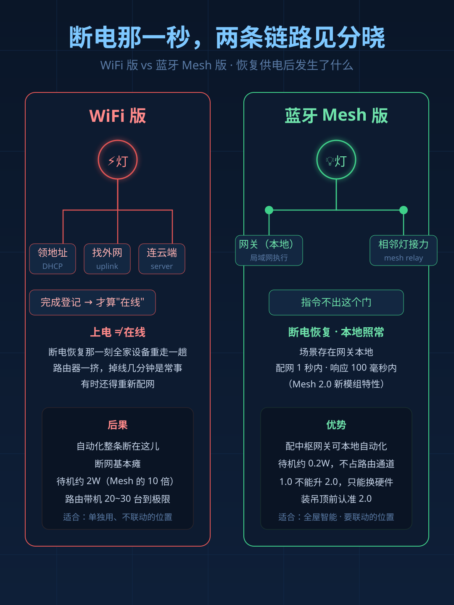
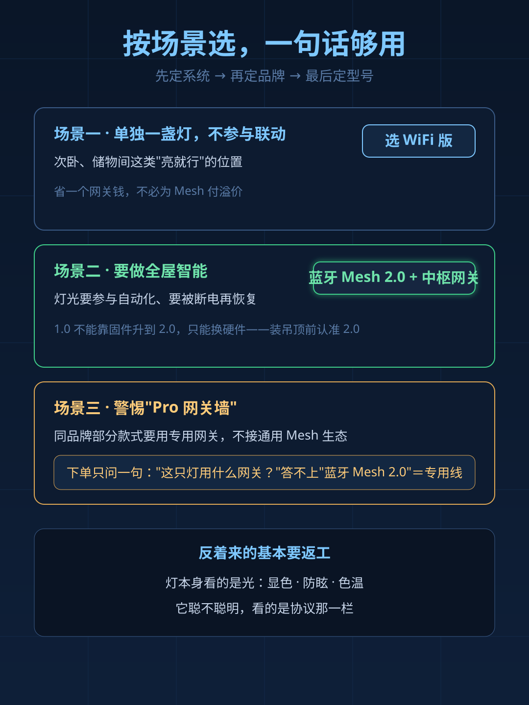

今年双11，吸顶灯成了全屋智能的"入场券"，晒家帖和讨论帖都扎堆在这个品类。但评论区问得最多的问题不是"哪个牌子好"，而是：**同一款灯，详情页里既有WiFi版又有蓝牙Mesh版，价格几乎一样，该买哪个？**

不少人随手选了WiFi版——不用网关、通电就能连App，听着最省事。装完半年才发现，两个版本的差别不在"能不能连手机"，在**断电之后，它还回不回得来**。

## 平时看不出来，断电那一秒现形

这个坑不是"偶尔不灵"，而是很有规律：平时手动开关、调亮度都没问题，所以买回来那阵子根本发现不了。差别出在**恢复供电那一秒**。

WiFi灯上电不等于在线。它要先领一个地址、再找到外网、跟服务器建立连接、完成登记——这一整套走完，云端才认为它在线，App和自动化才找得到它。断电恢复那一刻，全家WiFi设备都在重走这一趟，路由器一挤，掉线几分钟是常事，有时还得重新配网。灯光场景要的是"这台灯在线、能收指令"，它一掉线，整条自动化就断在这儿。

蓝牙Mesh版不走这条路。自动化场景存在网关本地，指令在局域网里就走完，不出这个门。断电恢复后，本地自动化照常执行，不存在"重新登记"这回事。

## 一张表看懂两个版本

| 对比项 | WiFi版 | 蓝牙Mesh版 |
|---|---|---|
| 接入方式 | 直连路由器，不用网关 | 连网关，灯与灯互相接力 |
| 断电恢复 | 重新连云端，常掉线 | 本地执行，秒回 |
| 断网可用 | 基本瘫 | 配中枢网关可本地自动化 |
| 单灯待机功耗 | 约2W，是Mesh的10倍 | 约0.2W |
| 路由带机量 | 20~30台到极限 | 不占路由通道 |
| 成组控制 | 各自连云端，延迟不齐 | 全开全关排队机制优化 |

特别说一句Mesh 1.0和2.0。能不能断网还用，靠的是"本地执行"这套架构，不是版本号本身；2.0真正强在三点：配网从几秒降到1秒以内、指令响应压到100毫秒以内、支持远程固件升级。最关键的是第三点反过来说——**1.0不能靠软件升到2.0，只能换硬件**。装进吊顶、埋进墙里的东西，买错一次就得拆一次。

## 按场景选，一句话够用

- **单独一盏灯、不打算参与联动**：WiFi版够用，还省一个网关钱。次卧、储物间这类"亮就行"的位置，不必为Mesh付溢价。
- **要做全屋智能**：认准蓝牙Mesh 2.0加中枢网关。下单顺序是先定系统、再定品牌、最后定型号，反着来的基本要返工。
- **警惕"Pro网关墙"**：同一品牌的部分款式要用专用网关，不接通用Mesh生态。下单前只问一句"这只灯用什么网关"，客服答不上"蓝牙Mesh 2.0"这串字的，基本是专用线——装完发现调不了光，退换都麻烦。

## 已经买错了？三条补救，不用拆吊顶

拆吊顶重开孔的代价远大于问题本身，先把这三条用上：

1. **让灯永远带电**。掉线的根源是断电后要重新连云端，那就不让它断电。灯这一路保持供电，状态一直在线。
2. **智能开关切无线模式**。开关还在原位置、面板不拆，只是从"直接通断电路"改成"只发信号"，开灯关灯交给自动化执行。三个前提：这盏灯支持"通电默认关闭"；开关本身支持切无线模式；App里建一条自动化接住按键。
3. **补一台中枢网关**。Mesh灯没网关照样没有本地自动化。顺带说个冷知识：部分用户遇到米家显示"未联网关"但功能一切正常，其实是灯组管理里"隐藏单灯"的开关误开了，先查这个设置再怀疑硬件。

## 双11收货前，四查清单

1. **查光通量**：详情页连流明数都不标的，无论多智能先扣分。按房间面积乘200流明粗算够不够。
2. **查固件**：到手看固件编号，304开头才是Mesh 2.0模组，别信详情页文案。
3. **查调光下限**：问客服最低亮度能到百分之几、有没有断电记忆——这才是智能灯和"连了App的灯"的分水岭。
4. **查协议依赖**：WiFi版数数家里路由器还带得动几个设备；Mesh版确认网关型号，别买了灯才发现网关不支持。

**FAQ**

Q：WiFi版是不是不能买？
A：不是。不参与联动、断了也不影响生活的位置留WiFi没问题；但灯这种要参与自动化、要被断电的设备，别赌WiFi。

Q：蓝牙Mesh一定要网关吗？
A：要。手机蓝牙能配对单个灯，但"断网也能用"的本地自动化必须配中枢网关，这是两件事。

一句话收尾：灯本身看的是光——显色、防眩、色温；它聪不聪明，看的是协议那一栏。别只盯着"支持App控制"，盯住"蓝牙Mesh"这几个字，双11这单就不会白下。
