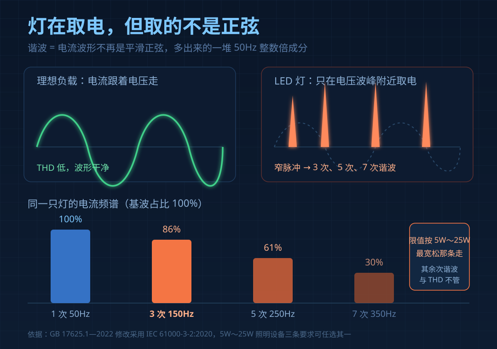
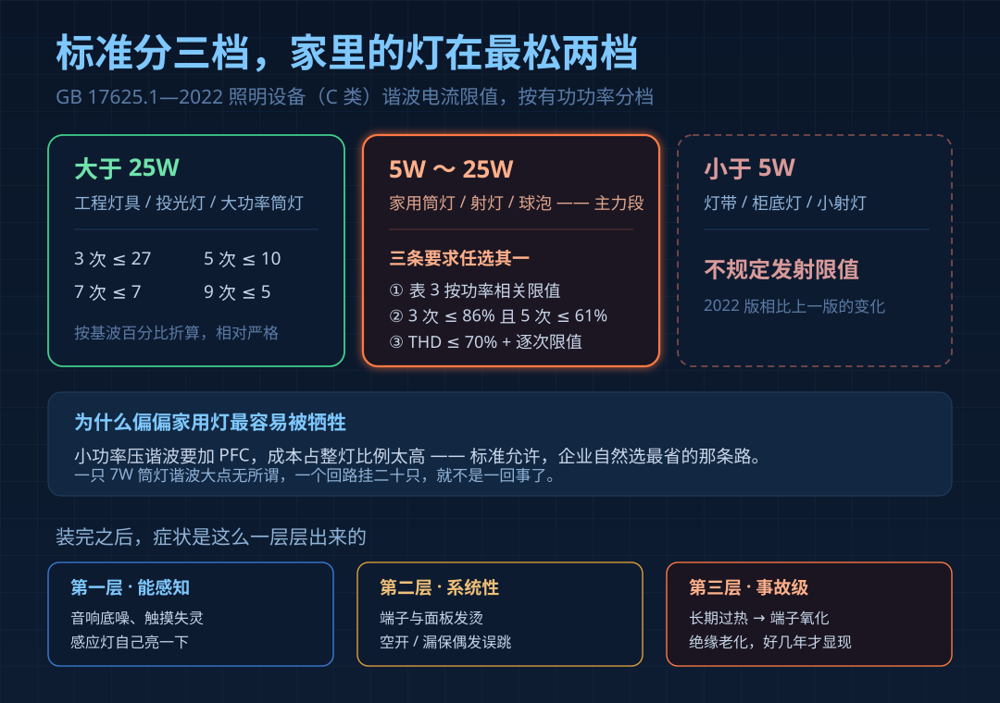
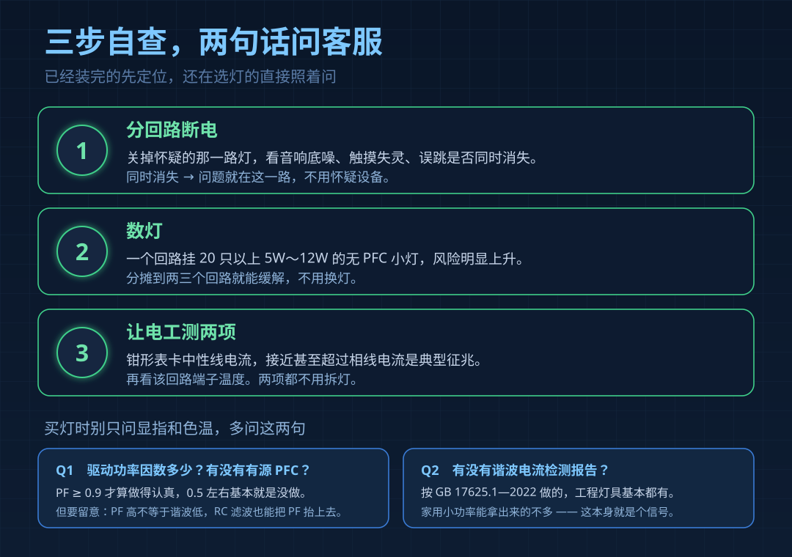

10月29日，广东省市场监管局发布2026年第132号通告，照明光源及灯具查出15款不合格，线上6款、线下9款。翻完清单，有一个词出现了11次——**谐波电流**，本轮最高频的不合格项，覆盖球泡、平板灯、投光灯、嵌入式。

这不是偶发。今年10月广东另一批抽检，两款知名品牌吸顶灯和柱形泡也栽在这一项；山东省级抽查里，欧普3批次球泡、松下1款固定式灯具同样判不合格。行业判断很直白：**平价流通款、电商专供款的风险，远高于工程高端款。**

问题是——这些灯买回家，是能亮的。

## "能点亮"和"达标"是两件事

被试灯摆在实验室里，通电、亮、调光正常，手机摄像头都拍不出异常。它测的是另一件事：**这盏灯从电网取电，干不干净。**

正常交流电是平滑正弦波。LED灯内部是开关电源：先整流，再靠一颗大电容把电压垫平。这颗电容只在每个半周电压接近峰值的一小段充电，其余时间几乎不取电，电流就成了一串又窄又尖的脉冲。

非正弦周期波形都能拆成正弦波叠加：50Hz基波，加上100Hz、150Hz、250Hz……这些整数倍成分就是谐波。LED单向整流取电，主要产生**奇次谐波，其中3次（150Hz）最大**。这些电流不做功，只在导线和变压器里来回跑，变成热。

## 家里的灯，正好落在标准最宽松的那一档

国标 GB 17625.1—2022（2024年7月1日实施，等同采用 IEC 61000-3-2:2020）把照明设备归为C类，但限值按功率分三档，宽松程度差得很远：

| 功率分档 | 限值要求 | 实际含义 |
|---|---|---|
| 大于25W | 3次≤27、5次≤10、7次≤7（按基波百分比折算） | 相对严格 |
| 5W～25W | 三条路任选其一 | 最省成本的那条只考核3次≤86%、5次≤61%，其余次谐波和THD都不管 |
| 小于5W | 不规定发射限值 | 完全不管 |

而客厅卧室的筒灯、射灯、球泡，绝大部分就在5W到12W之间；灯带、柜底灯常在5W以下。也就是说，**家用照明的主力功率段，恰好是标准里要求最松的两档。**

标准这么定有道理：小功率压谐波要加PFC，成本占整灯比例太高。但一只7W筒灯谐波大点无所谓，一个回路挂二十只，就不是一回事了。

## 一只灯没事，二十只灯在一个回路上

3次谐波有个特性叫"三倍频"。三相系统里它在每相上同相位，会在中性线上叠加而不是抵消。家里是单相进线，一个回路的灯越多，中性线电流叠得越厉害。

消防设计规范里这句话写得很重：≤25W灯具3次谐波允许到86%，会使**中性线电流大大增加，可超过相线电流2.5倍以上**。中性线按相线截面配，长期过流就是发热。

落到日常，症状是分层的：

**第一层，能感知但不会往灯上想。**同一回路的音响、收音机出现"滋"的底噪；触摸开关偶尔失灵；感应灯莫名自己亮一下。多数人以为设备坏了，换了还是这样。

**第二层，系统性的。**该回路端子、插座面板摸上去比别路热；空开或漏保偶发误跳，推上去又正常。再往下就是绝缘老化——要好几年才显现，显现时已经和灯没关系了。

## 三步自查，两句话问客服

1. **分回路断电。**关掉那一路灯，看音响底噪、触摸失灵、误跳是否同时消失。消失，问题就在这一路。
2. **数灯。**一个回路挂20只以上5W～12W的无PFC小灯，风险明显上升。分摊到两三个回路就能缓解。
3. **让电工测两项。**钳形表卡中性线电流，接近甚至超过相线电流是典型征兆；再看该回路端子温度。都不用拆灯。

买灯时，别只问显指和色温，多问两句：

**"这个驱动功率因数多少，有没有有源PFC？"** PF在0.9以上才算做得认真，0.5左右基本就是没做。但PF高不等于谐波低——有方案靠简单RC滤波把PF做上去，THD依然很高，所以还要问第二句。

**"有没有按GB 17625.1—2022做的谐波检测报告？"** 工程灯具基本都有，家用小功率能拿出来的不多。

## 工厂视角：省掉的那一块二

我们做驱动电源二十年，这块成本怎么被砍掉的，很清楚。一颗像样的有源PFC，核心是PFC电感、一颗高压薄膜电容、控制IC，再加驱动MOS，批量做下来一块到两块五。一只出厂价二十几块的筒灯，这一块二就是纯利润。

省的方式通常三种：一是不做，整流桥直接接大电容，PF掉到0.5以下；二是用填谷电路（两电容加三二极管）做假PFC，PF能到0.85，但THD依然难看，低压输入时还会闪；三是PFC做上了却省掉输入端共模电感，谐波勉强过，骚扰电压又超标——这轮抽检里，骚扰电压也是高频项。

所以这本质不是技术难题，是**成本取舍**。它成为重灾区，恰恰因为它是"能点亮、看不见、只有仪器测得出"的缺陷——用户感知不到，价格又压得死，它自然第一个被牺牲。

## 最后：一个最常见的疑问

**Q：灯能亮、能调光、没异味，是不是就合格？**

不是。谐波电流、骚扰电压、能效等级都属于"能点亮但不达标"的隐性项，靠使用感受判断不出来。这次被点名的几款，不少是有3C证书的——证书覆盖的是认证时的型号和驱动方案，问题出在批次和用料上。
