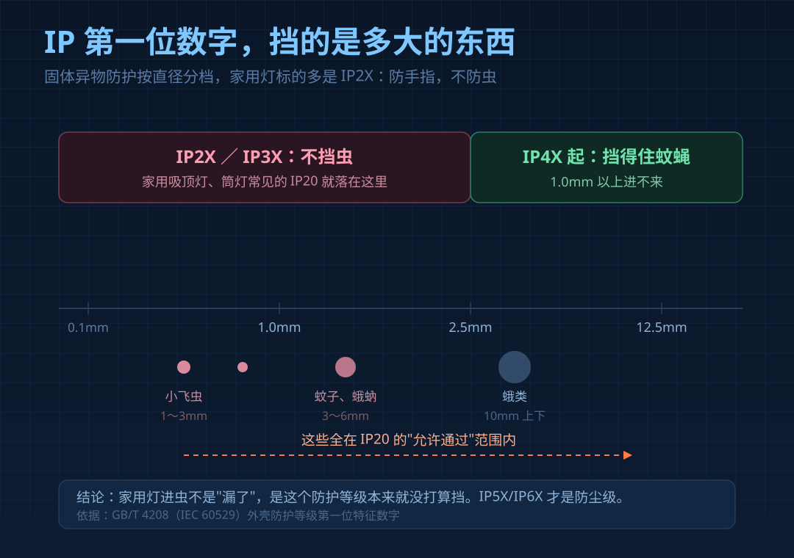
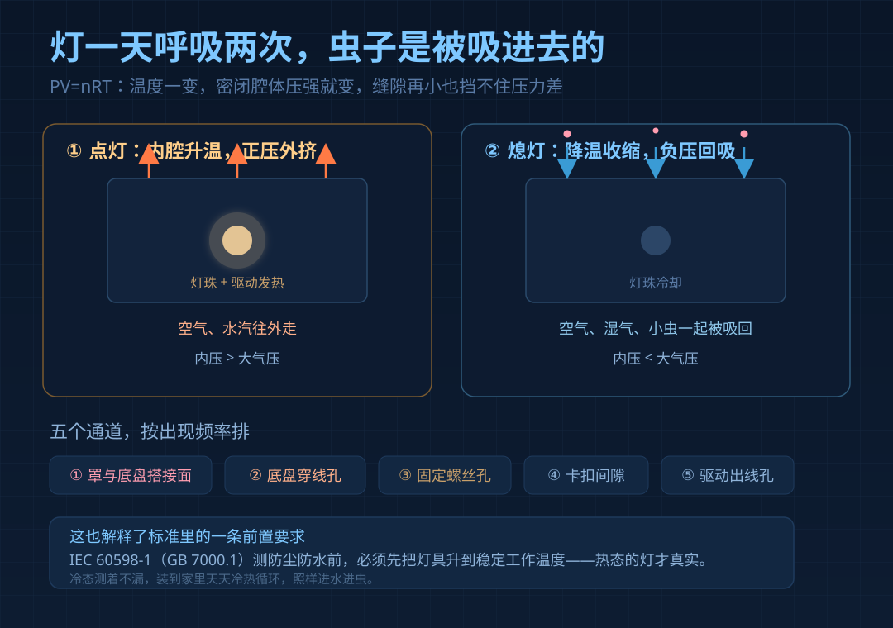
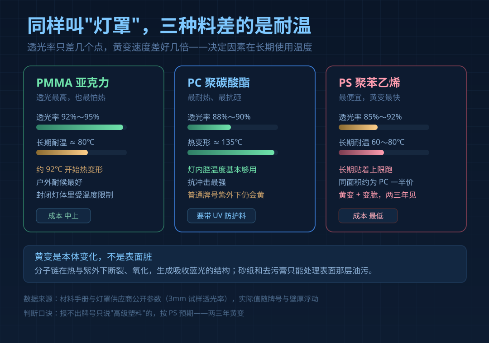

一盏用了三年的吸顶灯拆下来，罩子内壁发黄，底盘上一层虫尸和灰。主人的第一反应通常是"该擦擦了"。

擦不掉，方向也错了。**发黄和进虫是两件事，都不属于"脏"**：一件是塑料在灯内温度里本体老化，一件是家用灯的防护等级从设计上就不挡虫。

## 一、灯里为什么进虫：IP 等级本来就不防

包装上 IP 后面两个数字，第一位是防固体异物：

| 等级 | 挡得住的物体 | 挡不挡虫 |
|---|---|---|
| IP2X | 12.5mm 以上，即手指 | 不挡 |
| IP3X | 2.5mm 以上，工具、粗线 | 不挡 |
| IP4X | 1.0mm 以上，含蚊蝇、小昆虫 | 基本挡住 |

家用吸顶灯、筒灯、灯带电源绝大多数标 **IP20 或 IP23**——防手指，不防水，也不防虫。所以"进虫"在标准语境下不算质量事故，这个等级出厂就允许它进。真防虫得做到 IP4X，成本要贵一截，散热还变差。

## 二、呼吸效应：虫子是被"吸"进去的

就算缝隙只有零点几毫米，虫子也不是碰巧爬进去的。

灯点亮，灯珠和驱动发热，腔内空气升温膨胀，压力高于大气，气体从每条缝往外挤。关灯降温，腔内低于大气形成负压，外面的空气连同湿气、灰尘、小虫一起被吸回来。这就是**呼吸效应**，PV=nRT 讲的同一件事。

这不是假设。灯具安全标准 IEC 60598-1（对应 GB 7000.1）要求测防尘防水前先把灯升到稳定工作温度——冷态的灯不漏，热态的灯才漏。户外灯靠 ePTFE 呼吸器平衡压差，家用吸顶灯没这个件，只能靠结构和胶圈。

一年七百多次呼吸；虫子又趋光，往亮处飞。这就是为什么虫尸总聚在灯珠正上方。

**五个通道**：灯罩与底盘搭接面（无密封圈）、底盘穿线孔（没堵）、固定螺丝孔、卡扣间隙、驱动出线孔。

## 三、发黄不是污渍，是塑料本体变了

灯罩的透明塑料主要三种，价格和耐温差得很远：

| 材质 | 透光率 | 耐温 | 黄变倾向 | 成本 |
|---|---|---|---|---|
| PMMA（亚克力） | 92%~95%，最高 | 长期不超过 80℃ | 户外耐候最好，封闭灯体内受温度限制 | 中上 |
| PC（聚碳酸酯） | 88%~90% | 热变形约 135℃ | 普通牌号紫外下会黄，需带 UV 防护 | 偏高 |
| PS（聚苯乙烯） | 85%~92% | 长期 60~80℃ | 最易黄变，且变脆 | 最低，约为 PC 一半 |

机理不复杂：分子链在热和紫外线下断裂、氧化，生成吸收蓝光的结构；蓝光被吃掉，透过去的光就偏黄偏绿——**是材料变了色，不是表面附着的脏**。

砂纸、抛光膏只能处理表面油污和烟熏；本体黄变磨掉一层底色还是黄，还磨成哑光更易积灰。网上"灯罩洗白"的教程，多半是把污渍当成了黄变。

PS 最吃亏：长期使用温度上限只有 60~80℃，而灯内腔温度跟着功率和环境温度走。夏天关窗、灯又贴吊顶，长期贴着上限跑，黄变是必然。

后果不只是难看：透光率下降，同样的灯两年后看着暗一档；罩子等于加了层黄色滤片，4000K 看着像 3500K，显色也跟着偏。这和"色容差"是两件事——那是灯珠出厂的批间差异，这是罩子用旧引入的衰减。

## 四、虫尸不只是难看，它会烧驱动

虫尸和积灰堆的位置，通常就在驱动板和接线端子附近——整盏灯温度最高、电压最高的两处。

干虫尸绝缘，吸了潮气之后不是。堆在驱动引脚之间、接线端子上会形成微弱导电通路，行业里叫爬电；再久一点虫尸在高温下碳化，碳是导体，通路更实。结果就是局部短路、驱动烧毁。这时候换灯珠白花钱：驱动已坏，母线电压不对，新灯珠上去照样烧。

更常见的是慢性病：散热面被虫尸和灰堵住，驱动温度上去，电解电容加速老化，一两年后开始闪、亮度掉。用户以为是"这灯不耐用"，实际是散热被埋了。

**断电后四步自查**：验电笔确认无电 → 看灯珠有无黑点 → 看驱动板有无虫尸、黑渍、鼓包电容 → 看密封条是否硬脆、穿线孔有无胶塞。

三条红线：不泡水（水会进驱动和端子）、不用酒精和 84（PC 和 PS 遇醇类与碱会应力开裂）、不通电擦。

## 五、买时问三句，装时做两件

1. **罩子什么料？** 要 PC 带 UV 防护，或亚克力。报不出牌号只说"高级塑料"的，按 PS 预期——两三年黄变。
2. **有没有密封圈？** 硅胶优于 EVA 泡棉，泡棉两年粉化脱落，缝隙反而更大。
3. **穿线孔有没有胶塞，罩子能不能徒手拆？** 不能拆的罩子，意味着永远清不了里面那层虫尸。

装的时候两件事：穿线孔和多余螺丝孔用胶塞或中性硅酮胶堵上（别堵厂家留的排水、透气位）；底盘与顶面接缝薄薄打一圈胶，留出可拆位置。

老灯补救四步：拆罩 → 干刷加吸尘器清虫尸（不要湿布）→ 换硅胶密封条 → 堵孔装回。做不了这四步的灯，本质是一次性的。

## 常见问题

**灯罩发黄还能洗白吗？**
油污、油烟能洗掉，本体黄变洗不掉——擦完对着光比颜色，一致才是污渍。

**放樟脑丸能防虫吗？**
不建议在灯体内放化学品，灯内温度高会持续挥发。防虫只能靠堵通道。

---

灯罩发黄、灯里进虫，看着都是"用久了"。但一半原因在出厂那一刻就定了：料选了什么、孔堵没堵、圈装没装。用户能决定的只有后一半。
