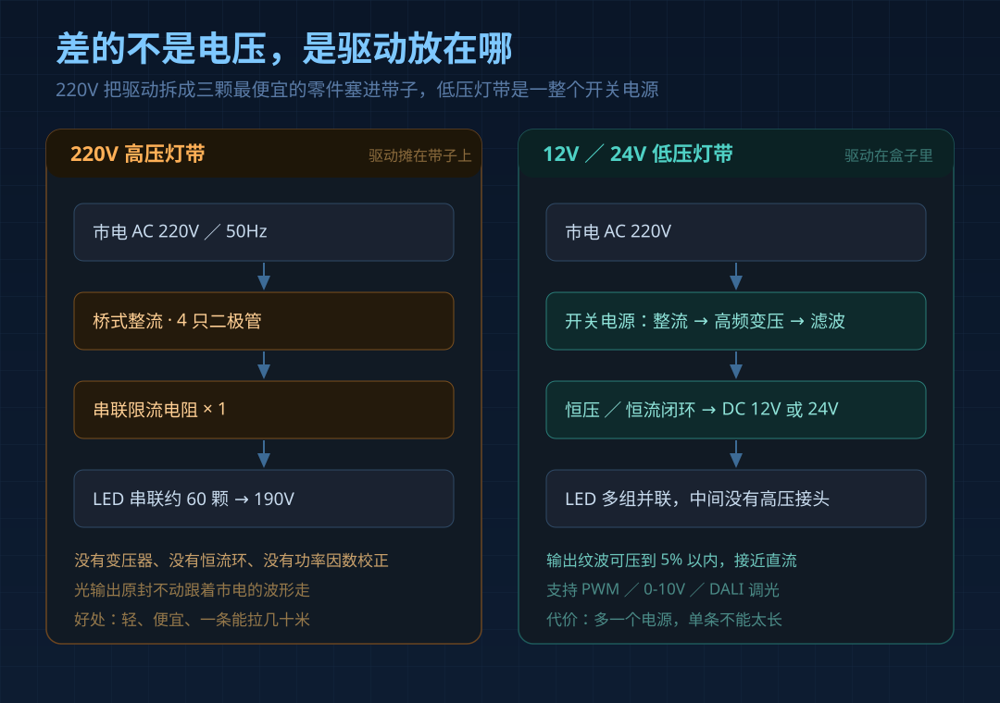
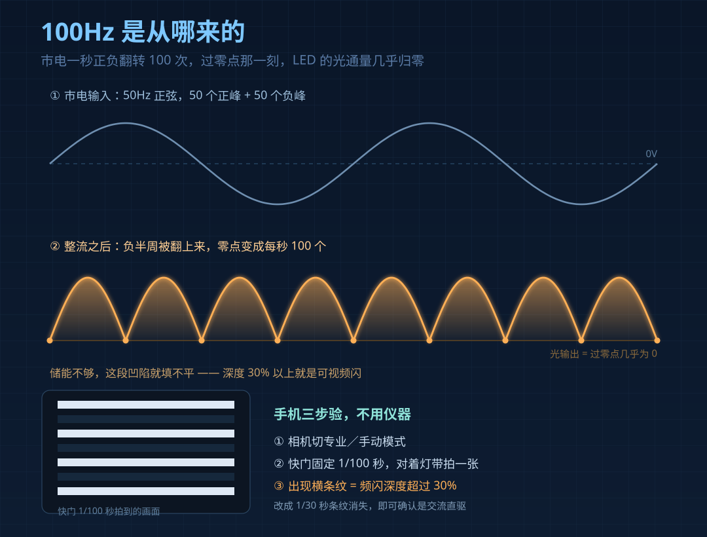
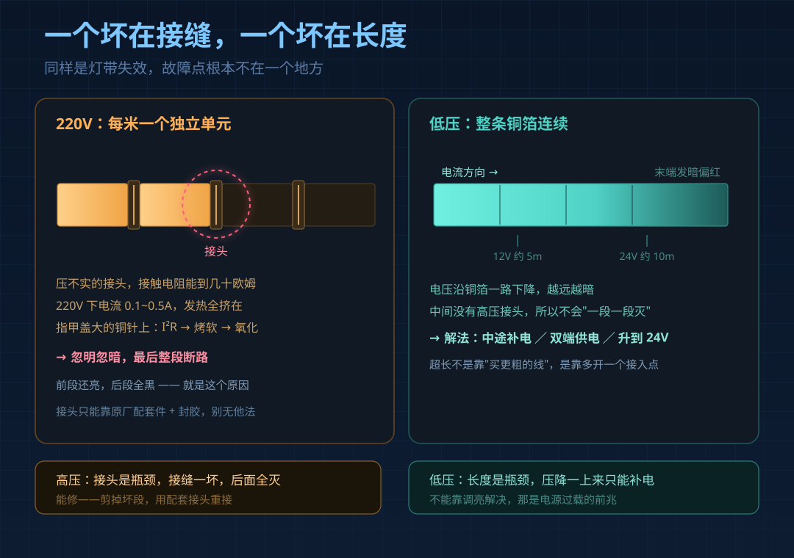

吊顶那道氛围光，装的时候师傅说"用高压的省事，不用装变压器"。

半年后问题来了：末端一段亮一段暗，或者一节一节地灭；手机对着拍，满屏横纹。

看到 220V 和 12V/24V，多数人以为只差"要不要多买个电源"。差别其实在驱动结构里，它决定三件事：闪不闪、耐不耐用、碰不碰得。

## 一、高压灯带不是"没有驱动"，是把驱动拆成了三样最便宜的零件

低压灯带外面那个方盒子是完整的开关电源：整流、滤波、高频变压、稳压闭环，成本二三十到上百。

220V 高压灯带把这一套塞进了灯带本身——桥式整流 + 一颗限流电阻 + 一小段电容。没有变压器，没有恒流环，也没有功率因数校正，电容只够"看着不闪"。

| 项目 | 220V 高压灯带 | 12V/24V 低压灯带 |
|---|---|---|
| 供电 | 直接接市电，内置整流+限流电阻 | 需开关电源 |
| 剪口间距 | 半米或一米一段 | 12V 每 3 颗、24V 每 6 颗（5-10cm） |
| 单条长度 | 30-100m 亮度几乎不衰 | 12V≤5m、24V≤10m，超长要补电 |
| 光输出波动 | 100Hz，深度常见 30% 以上 | 恒流方案接近直流 |
| 可触碰性 | 全线带市电 | 36V 以下安全电压 |
| 智能调光 | 基本只能整条可控硅调光 | PWM / 0-10V / DALI 均可 |

## 二、代价一：100Hz 频闪，手机一按快门就现形

市电 50Hz 正弦波，一秒正负翻转 100 次。LED 芯片响应在微秒级，电压过零点那一瞬，光通量几乎归零。中间没有足够的储能把这段填平，光就在以 100Hz 呼吸。

肉眼"看不出来"不等于没有。人眼会自动适应波动光，但长时间待在低频闪环境里，眼睛容易累，对光敏感的人和小孩更明显。

验证不用仪器：相机切专业模式，快门固定 1/100 秒对着拍。出现明显横条纹，说明频闪深度超过 30%；把快门降到 1/30 秒条纹消失，基本可以确认是交流直驱造成的。

能不能接受，看位置：书桌、床头、儿童区不能容忍；高位灯槽、纯装饰可以。

## 三、代价二：那些"一米一个"的接头，是段灭的真凶

高压灯带每一米是一个独立单元——几十颗灯珠串联加一颗限流电阻，单元之间用铜针或卡扣压接。这条缝是最脆弱的地方。

接触电阻压不实能到几十欧姆。220V 下电流不大（0.1~0.5A），但发热全集中在这个指甲盖大小的接头上，足够把塑料慢慢烤软、氧化、接触更差、更热。表现就是忽明忽暗，最后整段断路——前面还亮，后面全黑。

低压灯带整条铜箔连续，只有两端接电源，没有中间高压接头，这个问题天然不存在。它的软肋在另一头：压降。12V 单条超 5 米、24V 超 10 米，末端就发暗偏红，得从中间补电。

一句话记：**高压灯带的故障点在"接缝"，低压灯带的故障点在"长度"**。

## 四、代价三：安全边界

灯带通常塞在铝槽里，铝是导电的，而高压灯带整条都带着 220V。吊顶里还有潮气、有老鼠。

出厂时绝缘是够的，问题多出在安装：剪口没封胶、接头没防水、灯带被铝槽割破、接头是杂牌。这些在 24V 上最多是"不亮"，在 220V 上就是"外壳带电"。

验的时候有个硬指标：断电后用 500V 兆欧表测输入端对地绝缘，正常应在 2MΩ 以上；低于 0.5MΩ 说明已经受潮或内部击穿，这条带子不能再上电。

## 五、那高压灯带到底还能不能用

能，但要认清它省在哪。

它真正的优势是长距离和免电源：同功率下 220V 电流只有 12V 的十八分之一，线路损耗极小，一条拉 30-100 米亮度几乎不掉；老房改造、石膏线明装、没地方塞变压器的地方，只有它能干。

所以选择的逻辑不是"谁更好"，而是"装在谁碰得到的地方"：

1. **手能碰到、或长时间停留**——书桌、床头、儿童房、柜内，一律低压。
2. **高位装饰、人够不到、连续超 10 米**——客厅回光槽、顶角线、户外轮廓，高压可接受，但接头必须用配套件并封胶。
3. **已经装完只想换灯带**——先确认原来是不是 220V 直驱；是的话换带恒流模块的高压灯带（贵一点，频闪能压下去），或补一个电源位改低压。

## 六、收货四步验

1. 手机 1/100 秒拍一张，看横纹。
2. 量剪口间距：高压应为 50cm 或 100cm，低压 12V 约 5cm、24V 约 10cm。对不上就不是标称规格。
3. 看接头是否原厂配套。散装铜针加电工胶布，是后面闪和灭的主要来源。
4. 点亮十分钟后摸背面：烫手说明铜箔太薄或灯珠太密，寿命要打折。

## 常见问题

**高压灯带能不能调光？**
能，但只能整条一起调，靠可控硅调光器。可控硅削波和灯带内部整流桥配合很差，低亮度段容易闪、叫、掉光。想做调光调色，直接选低压。

**低压灯带一定要用原厂电源吗？**
功率电压对上就行，但余量要留：按灯带总功率 1.2 倍选，且不能封在灯槽里——开关电源自身发热，闷着寿命掉得比灯带还快。

**三色变光的 220V 灯带好用吗？**
它靠墙壁开关"开-关-开"切换色温，每次断电重置，没有记忆，也不能无级调。要"记住上次色温"，只能上低压智能方案。

---

一码归一码：高压灯带不是劣质品，它把成本和安装难度压到最低，代价是频闪、接缝和安全边界。家用照明的原则很简单——**人待得久的地方，别用市电直接驱动的东西**。
