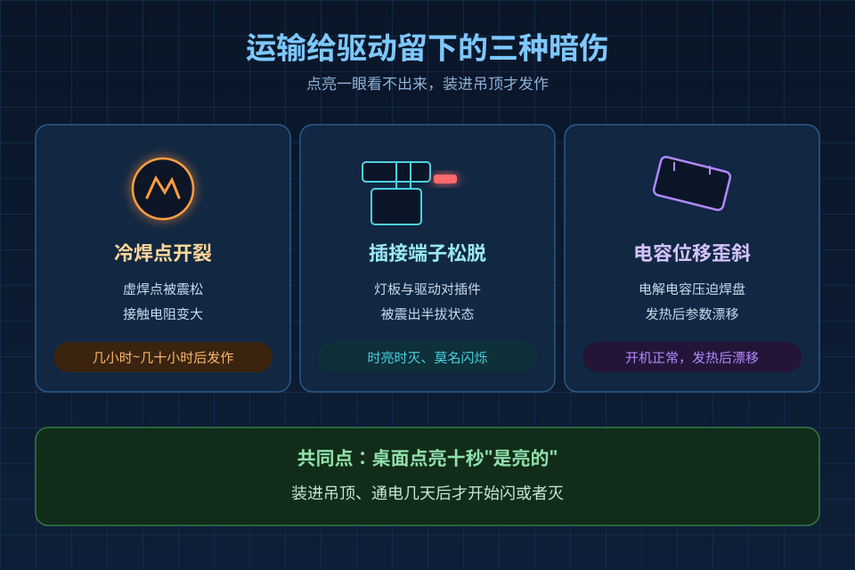
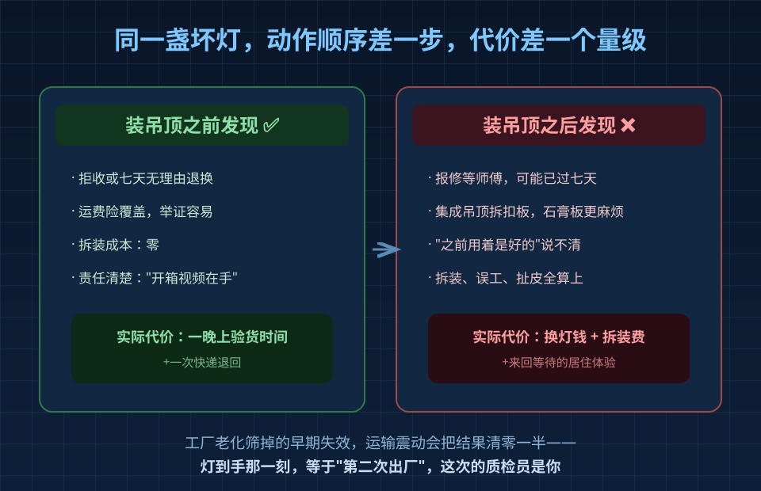
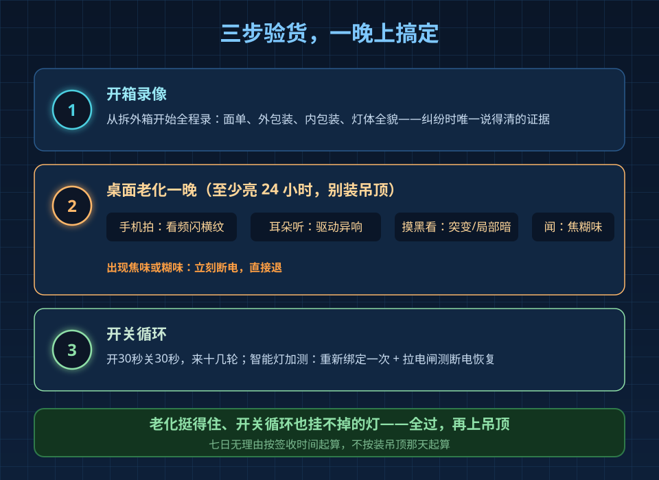

江苏一位装修记录员上个月发视频：618 囤的一箱十个筒射灯，放了一整个季度没拆封，双11 准备装灯时打开——十个全是坏的。评论区吵成三派，有说暴力快递的，有说批次问题的，做安装的企业号留言说这款灯他们收到很多师傅反馈"快递过来就坏"。

拆封真空期超过三个月，中间任何仓储搬运磕碰都无从举证，这话不假。但今天要说的重点不是怎么甩锅，而是一件更实际的事：**灯坏，往往不是坏在开箱那一刻看得见的地方。**

## 一、真正坑人的是"装进吊顶才发作"的暗伤

一盏 LED 灯 = 灯板 + 驱动电源。灯板上的灯珠坏没坏，点亮一眼就能看出来；但驱动里的毛病不是这样的。

驱动是一块塞满元器件的电路板：电解电容、变压器、功率器件、几十上百个焊点、几组插接端子。它怕两样东西——高温，和震动。

运输就是一路震动。结果通常是三种：

| 暗伤类型 | 机理 | 发作时机 |
|---|---|---|
| 冷焊点开裂 | 虚焊或焊料少的焊点被震松，接触电阻变大 | 通电升温后接触不良，几小时到几十小时 |
| 插接端子松脱 | 灯板与驱动的对插端子被震出半拔状态 | 时亮时灭、莫名闪烁 |
| 电容位移 | 电解电容歪斜压迫焊盘 | 开机正常，发热后参数漂移 |

共同点：**坏不当场发作**。桌面点亮十秒钟"是亮的"，装进吊顶，通电三天，某盏灯开始闪或者直接灭。

这时候你要付出的不只是换灯的钱。

## 二、装前发现和装后发现，是两个价

工厂出哪里面的灯，本来就有一道"老化"工序：整批灯架起来连续点亮，把早期失效的筛掉再装箱。可靠性工程里管这叫把失效"留在工厂里"，因为工厂里换一颗驱动是流水线上五分钟的事。

但运输把这套筛选的结果清零了一半——震动是老化房里没有的应力。所以你到手的那一刻，相当于这台灯"第二次出厂"，而这次的质检员是你自己。

| | 装吊顶之前发现 | 装吊顶之后发现 |
|---|---|---|
| 处理方式 | 拒收/七天无理由退换，运费险覆盖 | 报修，等师傅，可能已过七天 |
| 拆装成本 | 零 | 集成吊顶拆扣板；石膏板吊顶更麻烦 |
| 举证难度 | 开箱视频在手，责任清楚 | "之前用着是好的"说不清 |

同样一盏坏灯，动作顺序差一步，代价差一个量级。

## 三、三步验货，一晚上搞定

**第一步：开箱录像。** 从拆快递外箱开始全程录，完整拍到面单、外包装、内包装、灯体全貌。这是发生纠纷时唯一说得清的证据，市场监管部门双11 消费提示里反复强调的就是这一条。

**第二步：桌面老化一晚。** 别装吊顶。找张桌子，把灯架起来或者临时接根线吊着，通电连续亮 24 小时（嫌久至少亮一晚）。期间看四样：

- **频闪**：手机相机对着灯看，满屏横纹的直接退；
- **异响**：驱动嗡嗡声、滋滋声，耳朵贴近听，正常应该接近无声；
- **亮度稳定性**：中途摸黑观察有没有突然变暗、一闪一闪、局部一块发暗；
- **异味**：塑料焦味、糊味，出现立刻断电，直接退。

**第三步：开关循环。** 开三十秒、关三十秒，来个十几轮。焊接不牢的端子和启动电路最经不起这么折腾——老化里挺得住、开关循环里挂掉的，装上天花板迟早也是它。智能灯再加两项：重新绑定一次，拉一次电闸测断电恢复。

**全过，再上吊顶。**

## 四、什么现象直接退，不用争

- 开箱就发现灯罩裂纹、边框变形——外观件损伤直接退，别听"不影响使用"；
- 通电大面积频闪（手机横纹）——驱动纹波超标，退；
- 老化期间灭过一次又能亮——间歇性接触不良，装上吊顶就是"时好时坏"的经典剧本，退；
- 色温明显对不上标称、同批几盏颜色不齐——分 bin 问题，换货也难齐，退。

七日无理由和运费险是双11 买大件灯的标配权益，用足它。唯一要记住的是：**这些权益按签收时间起算，不是按你装吊顶那天起算**。囤了不拆、装了才发现，两头都吃亏。

## 常见问题

**Q：老化一晚会不会把灯"用旧"？**
不会。LED 灯标称寿命以万小时计，24 小时在寿命尺度上可以忽略。它筛掉的是本来就会在头几十小时里坏的"早夭"个体——这些灯装进吊顶也活不过保用期，提前暴露反而是赚。

**Q：整箱没拆封放着，以后再装行吗？**
可以，但拆封验货别拖过七天无理由期。至少开箱录像确认完好，通电亮一次确认没暗伤，再收起来等安装。一直不开箱等于放弃了验货窗口，坏了只能赌运气。

**Q：师傅上门安装时才发现坏了怎么办？**
当场拍照录像，让师傅在安装记录里写明"到场即坏"，联系卖家走换货。这也是为什么要自己先老化一遍——把发现环节从"师傅到场后"提前到"师傅到场前"，能省一次上门费，也省一轮扯皮。
