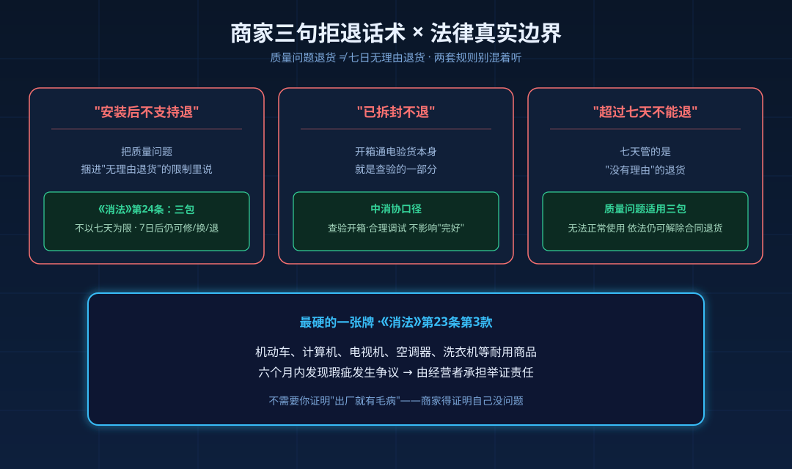
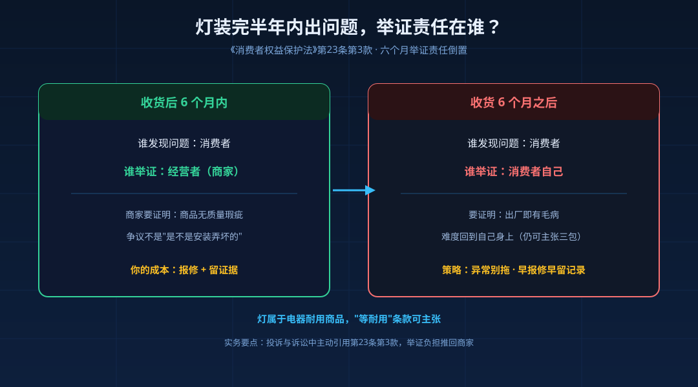
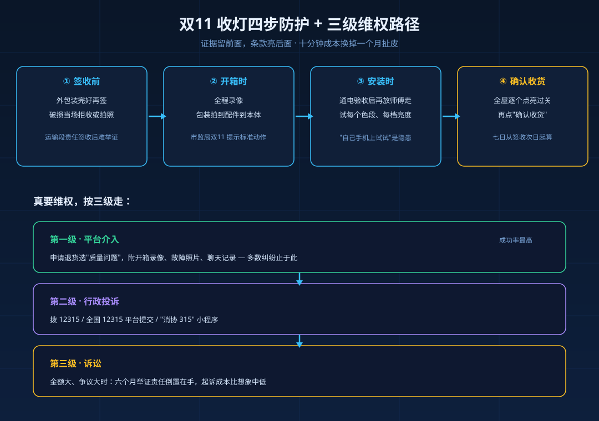

黑猫投诉平台上，11 月 4 日有一条双11 期间的投诉：消费者买的吸顶灯装上后调不出白光，安装师傅让"自己在手机上试一下"就走了，最后商家甩出一句——**安装后不支持退**。

类似的故事每年双11 后集中爆发。灯具和手机不一样：手机开机十分钟能验个八九成，灯要装上吊顶、通电，才能发现色温不对、频闪、嗡嗡响。等你发现时，往往已过七天，而且"装过了"。商家正是吃准这一点。但"装过了所以不退"这三句话，法律上一句都站不住。

## 一、"安装后不支持退"——混淆了两种退货

退货分两种，规则完全不同：

**个人原因退货**（买错了、不想要了）：远程购物享签收起七日无理由，这是《消费者权益保护法》第二十五条给的权利，但要求商品完好。

**质量问题退货**：走的是第二十四条——商品不符合质量要求，可以退货、更换、修理。这一条**不以七天为限**：七日内可退；七日后符合法定解除合同条件的，照样可以退。质量问题退货运费由经营者承担。

"安装后不支持退"这句话术，把质量问题和无理由退货捆在一起说。灯装上发现色温失控、调光失效、频闪超标，这是质量问题，压根不适用"无理由"那套限制。中消协在退货权消费提示里说得很直白：质量问题适用三包，不受七日无理由规则约束。

## 二、"已拆封不退"——拆封不等于不完好

很多灯的验货动作本身就是拆封：开箱、通电试亮、试调色温。商家常用"你拆了、装了"来认定商品不完好。

中消协的口径是：**消费者基于查验需要打开商品包装，或为确认品质功能进行合理调试，不影响商品完好**。所谓完好，指保持原有品质、功能，商品本身、配件、标识齐全——拆封和完好没有直接关系。商家不得单纯以"已拆封"为由拒绝退货，更不能用这个理由挡质量问题。

## 三、"超过七天不能退"——七天管的是"无理由"

这是最容易被误解的一条。七日时限管的是**没有理由的退货**；商品有质量问题时，适用三包：七日内可退换，七日后仍可要求修理、更换，故障严重到无法正常使用的，依法仍可解除合同退货。雷士旗舰店有过一单投诉：双11 买的灯延迟发货，12 月 23 日才签收，买家没开箱，1 月 10 日安装才发现质量问题，商家以"超七天"拒退——七天从签收次日起算，机械套"超七天"并不成立。

## 四、最硬的一张牌：六个月举证责任倒置

多数人不知道《消法》第二十三条第三款：**机动车、计算机、电视机、电冰箱、空调器、洗衣机等耐用商品，自接受商品之日起六个月内发现瑕疵发生争议的，由经营者承担举证责任**。

说白了：灯这类电器耐用商品，装完半年内出问题，不需要你证明"出厂就有毛病"——商家得证明自己没问题。很多纠纷卡在"怎么证明是质量问题不是安装问题"，这一款直接把举证负担推回商家。

## 五、收货季四步防护，把证据留在前面

法律条款是后手，证据是先手。双11 收灯，按这个顺序走：

| 步骤 | 动作 | 为什么 |
|---|---|---|
| 签收前 | 外包装完好再签，箱体破损当场拒收或拍照 | 破损责任在运输段，签收后难举证 |
| 开箱时 | 全程录像，从包装拍到配件、灯具本体 | 中消协及多地市监局双11 提示的标准动作 |
| 安装时 | 通电验收后再让师傅走：试每个色段、每档亮度 | 前面那单投诉里"师傅让手机上自己试"就是隐患 |
| 确认收货 | 全屋灯逐个点亮过关后再点"确认收货" | 七日从签收次日起算，别浪费在"还没装"上 |

最后一步尤其重要：电商的"确认收货"很多时候就是七日与售后的分界动作。灯没装、没验，先别急着确认。

## 六、真要维权，按三级走

1. **平台介入**：申请退货时选"质量问题"，附开箱录像、故障照片、聊天记录。多数纠纷停在这一层。
2. **行政投诉**：调解不成，拨 12315 或在"全国 12315 平台"提交，也可用"消协 315"小程序。
3. **诉讼**：金额大、争议大的，六个月举证责任倒置在手，起诉成本比想象中低。

## 常见问题

**问：安装费能一起退吗？**
质量问题导致的退货，经营者承担必要费用；额外的拆装、退运支出，可在投诉时一并主张。

**问：换货比退货省事，要不要接受？**
可以，但要防一个坑——部分商家要求"重新下单新灯、旧单退款"来走换货，退完差价容易扯皮。让客服书面确认差价与红包处理方式，别口头。

**问：过了很久才发现问题怎么办？**
六个月内瑕疵争议举证责任在商家，这是窗口期；超过六个月仍可主张三包，只是举证难度回到自己身上——灯有异常别拖，早报修早留记录。

灯这个行业，好产品和坏产品用的常常是同一套宣传图，区别在坏了之后商家那句话的成色。双11 收货这一周，录像拍好、验收做完、确认收货按慢一点——十分钟的成本，省下的是几百块安装费和一个月的扯皮。
