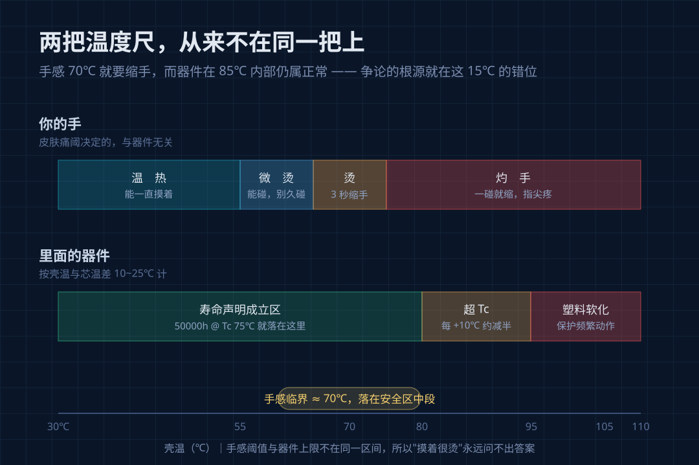
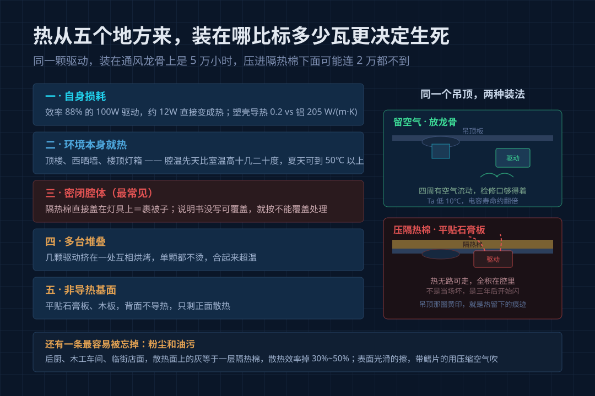
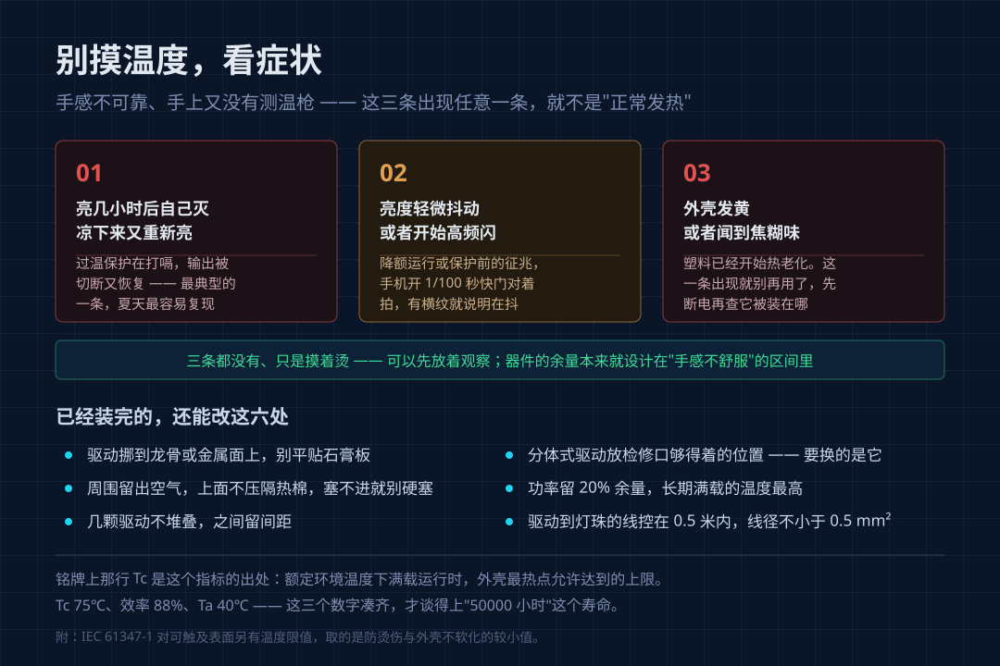

双11 装的灯，这两天上墙了。很多人第一次把手伸进吊顶里摸那颗驱动电源，会被烫到缩手——巴掌大的塑料盒子，摸着比暖气片还凶。

问客服，回答几乎统一：**"LED 都发热，这是正常的。"**

这句话一半对一半错。发热确实是常态；但**"正常"有前提、有上限**，上限就印在外壳上，只是没人告诉你去哪看。

## 一、"烫"是手感，不是温度

你的手不是温度计。

45℃ 左右摸着温热，像偏热的洗澡水，能一直摸；55 到 60℃ 能碰，但不想一直碰；**到 65℃ 以上，手背撑不住 3 秒就得缩**；75℃ 以上一碰就缩、指尖发疼。

行业里那句"手能停留 3 秒算正常"，门槛换算下来大约 70℃。

问题在于，**70℃ 对电子件根本不算高**。一颗标 105℃／10000 小时的电解电容，装在 70℃ 的壳子里，内部芯温约 85 到 95℃，仍在额定范围内。

> 手感开始受不了的温度，正好落在器件还能安稳工作的区间中段。

这就是这个争论永远没结论的原因——**你用手在问一个器件问题，客服在用器件标准回答一个手感问题**，两套语言从来没对上过。

## 二、该看的不是手感，是外壳上那个 Tc

正规驱动的铭牌上，除输入输出电压电流，通常还印着一行 `Tc: 75℃` 或 `Tc: 80℃`。

Tc 指的是：额定环境温度下满载运行，外壳上**指定最热点**（一般靠近 MOS 管或输出二极管）允许达到的最高壳温。它同时是两件事的依据——IEC 61347-1 对可触及表面的限值（防烫伤，也防塑料壳软化），以及寿命声明的测试条件。

所以"50000 小时"从不独立存在，完整写法是 **50000 小时 @ Tc 75℃**。壳温超了，这个数字立刻作废。工程上的经验值是壳温每升 10℃，电解电容寿命大约减半。

配套的另一个参数是 Ta，环境温度。这里几乎所有人都理解错：**Ta 不是客厅的 22℃，是驱动实际待的那个腔体的空气温度**。嵌在吊顶里、闷在灯体后腔、塞进密闭接线盒，Ta 比室温高出十几二十度很正常，夏天吊顶内测到 50℃ 以上不稀奇。

一颗按 Ta 40℃ 定寿命的驱动，装进 70℃ 的腔体，寿命不是打折，是断崖式下滑。

## 三、热从五个地方来，装在哪比标多少瓦更决定生死

**一，它自己的损耗。** 效率 88% 的 100W 驱动，有 12W 左右直接变成热。塑壳导热系数约 0.2 W/(m·K)，铝是 205，差三个数量级，热在壳里散不开。

**二，环境本身热。** 顶楼、西晒墙、楼顶灯箱，腔温先天就高。

**三，密闭腔体。** 最常见也最冤：隔热棉直接盖在灯具上，等于给它裹了床被子。说明书没写"允许被隔热材料覆盖"的，就按不能覆盖处理。

**四，多台堆叠。** 几颗驱动挤在一处互相烘烤，单颗都不热，合起来超温。

**五，非导热基面。** 平贴石膏板、木板，背面不导热。

再加一条：**粉尘油污**。后厨、木工车间、临街店面，散热面上的灰等于一层隔热棉，效率掉三到五成。

所以**决定这颗驱动活几年的，往往不是标了多少瓦，而是它被塞在了什么地方。**

## 四、判据不是温度，是三条症状

手感不可靠、手上又没有测温枪，靠什么判断？靠症状。下面三条出现任意一条，就说明它不是"正常发热"：

1. **亮几小时后自己灭，凉下来又重新亮**——过温保护在打嗝，输出被切断又恢复；
2. **亮度轻微抖动或高频闪**——降额运行、保护前的征兆；
3. **外壳发黄、有焦糊味**——塑料已开始热老化，这条出现就别再用了。

三条都没有、只是摸着烫，可以先放着观察。有第一条或第三条，先断电，再去查它被装在哪。

## 五、装的时候给热留一条路

- **驱动挪到龙骨或金属面上**，别平贴石膏板；
- **周围留空气**，上面不压隔热棉，塞不进就别硬塞；
- **不堆叠**，几颗之间留间距；
- **分体式驱动的，放检修口够得着的位置**——三年后要换的正是它，不是灯珠；- **功率留 20% 余量**，长期满载的温度最高；
- **驱动到灯珠的线控在 0.5 米内**，线径不小于 0.5 平方毫米——超过 1 米压降明显，"灯亮着但不够亮"常常是这段线造成的。

## 六、下单前问四句

1. 这颗驱动的 **Tc 是多少度**？
2. **Ta 按多少度**标，寿命声明给的什么壳温条件？
3. **效率**多少？（同样 100W，88% 和 93% 差 5W 的热）
4. 驱动**一体还是分体**，坏了能不能单独换？

正规厂家都拿得出来。拿不出来的，通常不是忘了标，是不想让你比。

## 常见两问

**裸机放桌上测出 70 多度，是不是翻车？**

裸测和装机是两条完全不同的散热路径。桌上无铝体、无腔体，条件比装进吊顶差得多，这个数只能当参考上限。今年 7 月有用户把筒射灯裸机点亮、测到驱动七十多度，还把人造蜡烛盒里的蜡热化了——但这是极端测法：装进石膏板吊顶、贴住铝体之后，热阻路径完全变了。

**摸着烫，但用了一年没坏，要不要管？**

没有前面那三条症状就不用动。器件余量本来就设计在"手感不舒服"的区间里，真正要动手的信号是症状。

---

发热最容易被误判的地方在于它慢：不会当场坏，是三年后开始闪、五年后不亮。到那时人只会说"这灯质量不行"，很少有人回头想起——它当年是被一块隔热棉盖着过完的第一个夏天。
