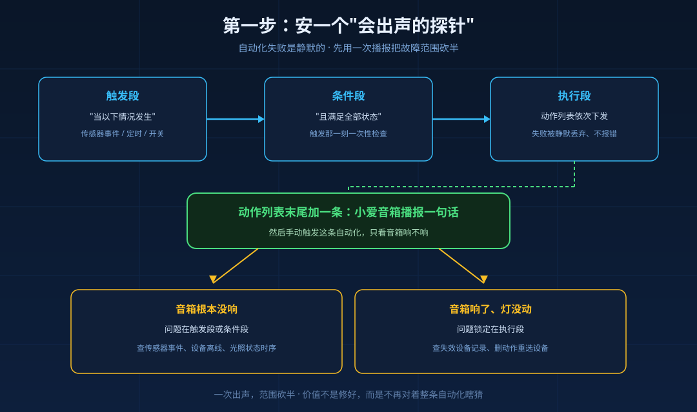
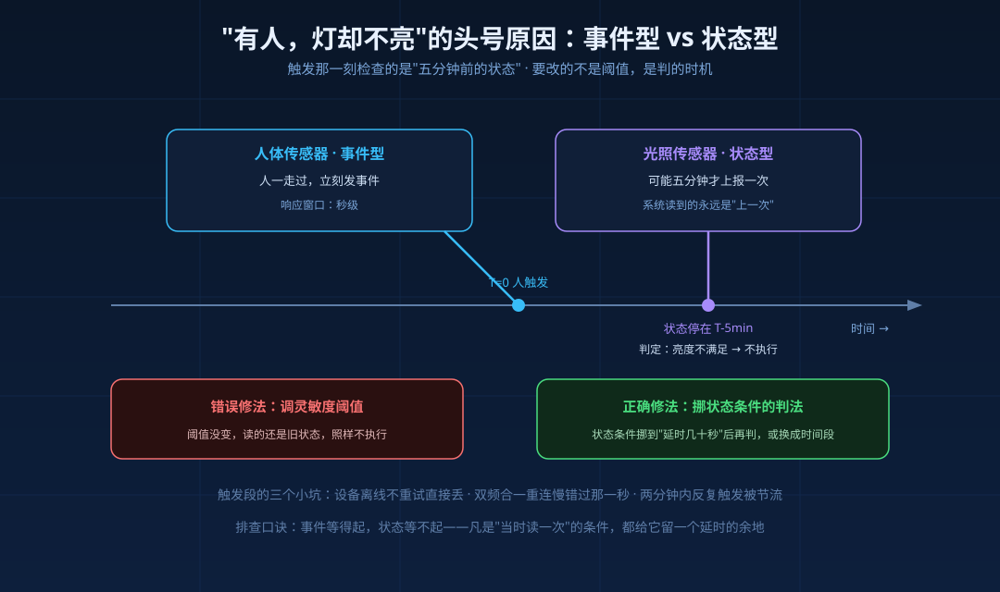
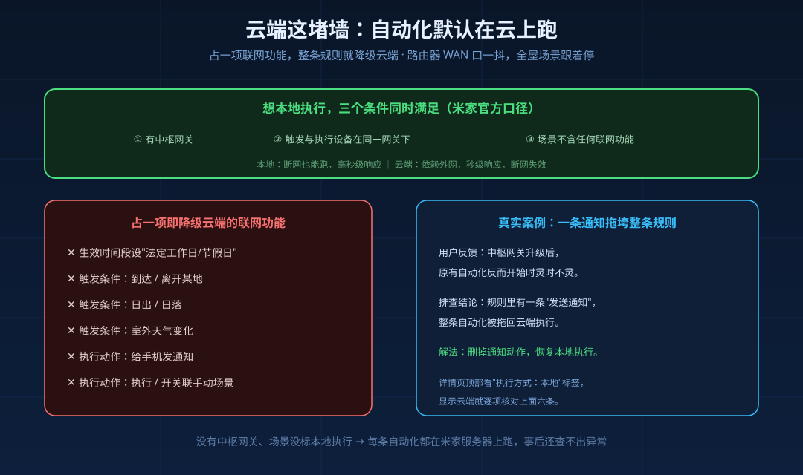

双11的快递拆完，电池贴好，你对未来充满信心：从此人来灯亮、人走灯灭。结果三天后就开始怀疑人生——明明有人走过去，灯就是不理你；说好十一点关灯，它装死；昨天还灵，今天就失灵。

先别急着骂设备。折腾智能灯的老手有个共识：**自动化不执行，九成不是设备坏了，而是"触发、条件、执行"三段里有一段空了。**麻烦在于，米家的失败是静默的——哪一段空了，它不说。

## 第一步：安一个"会出声的探针"

在这条自动化的动作列表最后加一条"小爱音箱播报一句话"，内容随便写，然后手动触发一次：

- 音箱响了、灯没动——问题在**执行段**；
- 音箱根本没响——问题在**触发段或条件段**。

一次出声，范围直接砍半。这一步的价值不是修好，而是不再对着整条自动化瞎猜。

## 触发段："有人，灯却不亮"的头号原因

"当以下情况发生"负责触发，"且满足全部状态"是在触发那一刻检查的——**它们不是同一回事。**

人体传感器是事件型，人一走过立刻发事件；光照传感器是状态型，可能五分钟才上报一次亮度。人走过走廊的瞬间，系统读到的是五分钟前的光照值，判定"不满足条件"，整条自动化就安静地不执行。

要改的不是灵敏度阈值，而是**把状态条件挪到"延时几十秒"之后再判**，或者干脆换成时间段条件。

触发段还有三个小坑：设备当时离线，米家不重试、动作直接丢；WiFi 设备开着"双频合一"重连慢，恰好错过那一秒；一两分钟内反复触发会被节流，动作前加个"延时30秒"再复查。

## 执行段：最隐蔽的"失效设备记录"

执行段最阴的坑是**失效设备记录**：设备删掉重加过、或从别的家庭转移过，自动化里那条动作界面上看着完全正常，底层却指向旧记录，执行时被直接丢弃、不报错。

凡是"重装某个设备之后，这条自动化就不灵了"，八成是它——把动作删掉重选一遍设备就好，不用删整条规则。

## 云端这堵墙：自动化默认在云上跑

家里没有中枢网关、场景也没标"本地执行"，那么每一条自动化都在米家服务器上跑——路由器 WAN 口一抖、米家服务器一波动，自动化就不执行，事后还查不出异常。

按米家官方口径，想本地执行要同时满足：触发设备与执行设备都在同一个网关下，且**场景中不能包含任何需要联网的功能**。占一项，整条规则就降级为云端：

| 联网功能（占一项即降级云端） |
|---|
| 生效时间段设"法定工作日 / 法定节假日" |
| 触发条件：到达/离开某地 |
| 触发条件：日出 / 日落 |
| 触发条件：室外天气变化 |
| 执行动作：给手机发通知 |
| 执行动作：执行/开关联手动场景 |

有用户中枢网关升级后自动化反而失效，最后查出来就是一条"发送通知"把整条规则拖回了云端——删掉通知，恢复本地。

## 没思路时，按这个顺序查，日志不会说谎

1. **网关在线**：米家 App → 我的 → 中枢与网关，看主网关状态（30秒，约一半的问题出在这）；
2. **设备在线**：列表里灰色小点=离线，触发和执行设备都要看（30秒）；
3. **执行方式**：自动化详情页看是否标"本地"（30秒）；
4. **逻辑**：检查"且/或"关系、生效时间段有没有互相打架（2分钟）;
5. **日志**：极客版右上角日志，或自动化详情页"执行记录"。

日志是最准的分诊台：**没有触发记录**，查传感器上报和网关接收，别去查灯；**有触发没执行**，问题锁定在执行段。方向对了，问题就解决了一半。

## FAQ

**Q：灯自己半夜亮了，也是自动化的问题吗？**
大概率是。先打开 App 通知中心看自动化记录，是不是某条人感或门磁误触发；另一类是灯控线接法问题，让电工把灯走智能开关面板的接线，从根上避开设备自主开灯。

**Q：同一只灯，米家里显示在线但不执行？**
"在线"只代表状态可读，不等于触发过、更不等于执行过。按探针法砍半，再看执行记录确认卡在哪一层。

**Q：买灯时要不要问"能不能本地执行"？**
要，但更好的问法是"这条联动跑在哪"：有中枢网关、触发和执行设备同网关、不含联网功能，断网也能跑；只有云端执行的房子，路由器重启一次，全屋场景跟着停一次。

灯是灯，自动化是自动化。灯坏了换驱动换灯板，自动化不灵查的是链路——先让小爱说句话，再动手。
