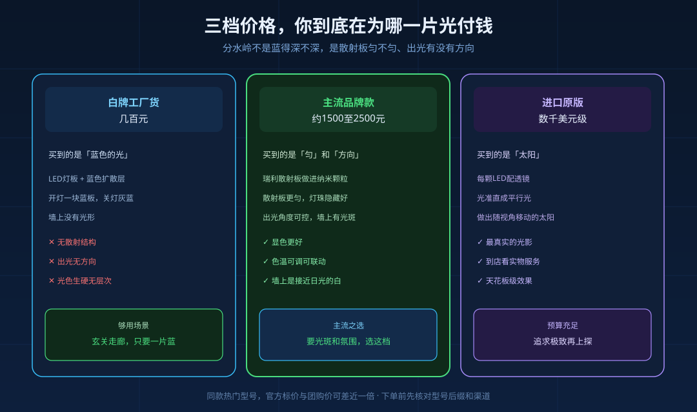
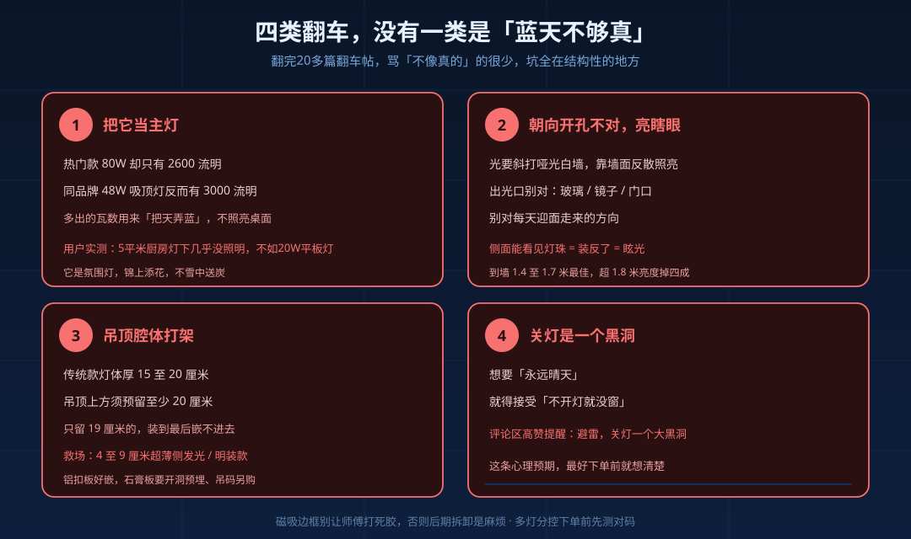
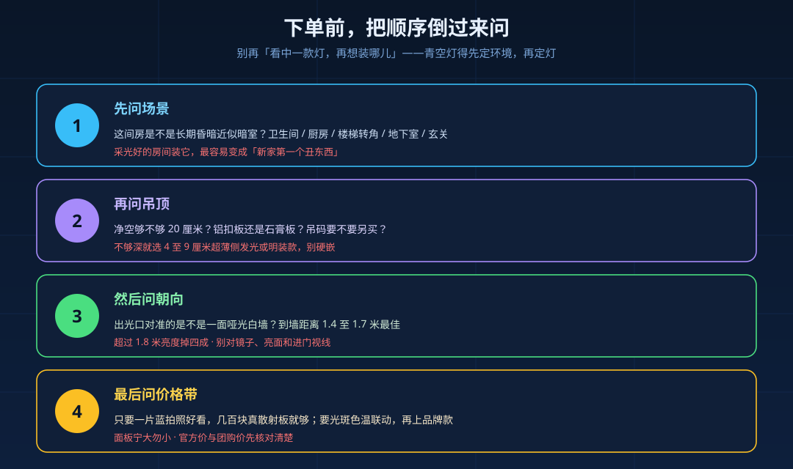

双11装修群里有人晒图：花两千多装的青空灯，从房间走出来被顶上那片光刺得睁不开眼。底下几百条评论，一半说"我家也这样"，一半说"你装错地方了"。

我做灯具十几年，这种帖子看得多。**青空灯翻车，几乎从来不是灯坏了，而是买之前有三个问题没问自己。**两千块的灯和八百块的灯，装错地方，会以一模一样的方式翻车。

## 先弄清你买的是什么：一扇窗，不是一盏灯

青空灯不是给灯罩印了张蓝天图案。它那片"天空"靠的是**瑞利散射**——把纳米级颗粒做进板材里，让短波蓝光向四面八方散开，透过板子的光仍然是接近日光的白色。所以你抬头看到的是蓝，洒到墙上的却是白光，这才像一扇真的窗。

便宜的做法就省事了：一块LED灯板加一层蓝色扩散层，开灯是一块发蓝的板，关灯是一块灰蓝的板，墙上没有光形。有些甚至只是RGB混色，光色生硬、没有层次。

记住一句话：**青空灯卖的是"暗室里凭空多出的那扇窗"，不是照明。**想靠它照亮桌面，从一开始就买错了东西。

## 差价钱花在哪：那片蓝不值钱，值钱的是光的"方向"

价格从几百到上万，跨度离谱，但拆开看就三层：

| 档位 | 典型价格 | 你实际买到的 |
|------|---------|------------|
| 白牌工厂货 | 几百元 | 蓝色扩散层，能亮、能蓝，墙上没光形 |
| 主流品牌款 | 约1500~2500元 | 散射板更匀、出光角度可控、显色更好，墙上有光斑 |
| 进口原版 | 数千美元级 | 每颗LED配透镜、把光准直成平行光，能做出随视角移动的"太阳" |

第一道分水岭不是"蓝得深不深"，而是**散射板匀不匀、出光有没有方向**。低价买的是"蓝色的光"，中价买的是散射板均匀度和灯珠隐藏，高价才买到透镜结构和场景联动。

还有一笔账是渠道。同一款热门型号，官方标价和团购价能差出近一倍，下单前先把渠道和型号后缀核对清楚，别只看"多少钱"。

## 四类翻车，没有一类是"蓝天不够真"

翻完二十多篇翻车帖，骂"不像真的"的其实很少，坑全在结构性的地方：

**一、把它当主灯。** 这是最高频的错。热门款功率做到80W，光通量却只有2600流明；同品牌48W的普通吸顶灯反而有3000流明——多出的瓦数，相当一部分是用来"把天弄蓝"，不是用来照亮桌子。有用户实测5平米厨房，灯下几乎没有照明，还不如20W平板灯。**它适合锦上添花，不适合雪中送炭。**

**二、朝向和开孔不对，喜提"亮瞎眼"。** 青空灯的光要斜着打到一面哑光白墙上，靠墙面反散照亮空间。对着玻璃、镜子、门口，或者人每天迎面走来的方向，就会眩光。出光方向别对亮面、别对进门视线，这是厂家和安装师傅的红线。

**三、吊顶腔体打架。** 传统款灯体厚15~20厘米，安装方要求吊顶上方预留至少20厘米；平嵌、深嵌、无边框的要求更高。留了19厘米的，装到最后就是"嵌不进去"。近两年才有4~9厘米的超薄侧发光和明装款救场。铝扣板吊顶师傅能顺手嵌进去，石膏板顶要开洞预埋、吊码配件常常另购。还有个细节：磁吸边框别让师傅打死胶，不然后期拆卸是个麻烦事。

**四、关灯是一个黑洞。** 想要"永远晴天"，就得接受"不开灯就没窗"。这条心理预期最好下单前就想清楚。

## 下单前，把顺序倒过来问

多数人是"看中一款灯，再想装哪儿"，青空灯得反过来：

1. **先问场景**：这间房是不是长期昏暗、近似暗室（卫生间、厨房、楼梯转角、地下室、玄关）？采光好的房间装它，最容易变成"新家第一个丑东西"。
2. **再问吊顶**：净空够不够20厘米？铝扣板还是石膏板？要不要另买吊码？
3. **然后问朝向**：出光口对准的是不是一面哑光白墙？到墙距离控制在1.4~1.7米最好，超过1.8米亮度会掉四成。
4. **最后问价格带**：只要抬头一片蓝、拍照好看，带真散射板的几百块款就够；要墙上有清晰光斑、早晚色温变化、智能联动，再考虑品牌款。面板宁大勿小。

这四问任何一个答不上来，先别下单。

## 三问三答

**青空灯能当卫生间的主灯吗？** 不建议。它是氛围灯，暗卫里也建议保留一路基础照明；只装它，调到最亮也照不亮。

**几百块的就一定是智商税吗？** 不一定。认清它只是"一片蓝"，用在玄关、走廊做氛围，几百块够用；用"真天空"的期待去买，才会觉得亏。

**装了效果不好能补救吗？** 朝向和距离问题还能调；吊顶深度不够、开孔位置错了，基本只能返工。所以这一步宁可在下单前多量一次尺寸。

---

青空灯是个好东西，但它是给"没有窗的房间"准备的，不是给"想省一盏灯"的人准备的。把场景、吊顶、朝向、价格这四件事对清楚，它就是你天花板上凭空多出的那扇窗；对不清，它就是两千块买来的一个教训。
