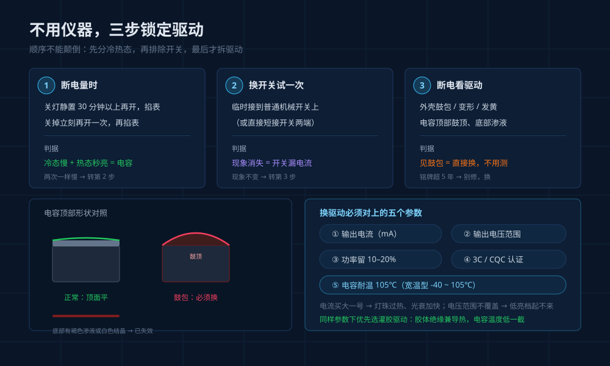

Last week a customer called about the light on his parents' balcony. "It's broken," he said — flip the switch at night and you wait two or three seconds before anything happens. He wanted a quote for a replacement LED panel.

I asked him to do one thing: switch it off, then on again immediately. It came on instantly.

So the light wasn't broken. That sequence — slow after sitting off, instant right after being on — has already completed most of the diagnosis: **the problem is in the driver's startup stage, nothing to do with the LED chips, and swapping the panel is money down the drain**. Once winter arrives, calls like this come in waves.

## Three Kinds of "Slow" — Only One Is a Fault

**Soft-start: normal.** Any decent driver includes a power-on soft-start to suppress inrush current and protect the LEDs. The signature is a 0.3–2 second ramp-up that's **identical on day one and a year later**, with no loss of brightness.

**Capacitor aging: fault.** The signature here is that it **gets progressively slower**: a fraction of a second at first, two or three seconds a year later, then flickering before it stabilizes, occasionally coming on at half brightness, and finally not lighting at all. This is the most common failure path for household LED fixtures.

**Switch or wiring mischief.** Smart switches, wall switches with indicator LEDs, and single-live-wire powered switches all leak a tiny current when "off," confusing the driver's power-on logic. The result: delay, faint flicker, or a light that never fully goes dark.

Telling them apart takes one move: **swap in an ordinary mechanical switch and test again**. If the symptom disappears, it was case three. If it stays and keeps getting worse, it's case two.

## Why It's the Capacitor, of All Things

LED chips don't mind the cold — at lower temperatures their efficiency actually improves slightly. The component in the whole fixture that hates the cold the most, and ages first, is the aluminum electrolytic capacitor on the driver board.

A capacitor conducts ions through an electrolyte. At room temperature the electrolyte is thin, the ions move fast, and the equivalent series resistance (ESR) stays low, so the capacitor charges to its working voltage almost instantly at power-on. Drop the temperature and the electrolyte thickens — **ESR climbs by multiples**. At -20℃ it runs three to five times its room-temperature value, a commonly cited industry figure.

With high ESR, charging slows down at power-on, and the output takes longer to climb to the chip's startup threshold. That's your two or three seconds. Once the circuit is running and its own heat warms the board, the capacitor regains its liveliness and everything behaves. **So the symptom is "slow the first time, fine afterward" — not slow all the time.**

Heat is the other enemy. Electrolytic capacitors follow a rule of thumb: **every 10℃ rise in temperature roughly halves their lifetime**. Sealed inside a downlight with the ceiling plenum hitting fifty degrees in summer, one ages several times faster than in a ventilated spot — which is why, within the same batch of fixtures, the bathroom one dies first and the balcony one slows first.

## Which Fixtures Fail First

| Location | Main cause | Typical symptom |
|---|---|---|
| Balconies, porches, garages, storage rooms | Low ambient temperature in winter | Startup delay after the first cold nights |
| Unoccupied homes, vacation houses in cold regions | Prolonged low temperature plus long periods unpowered | Delay grows from seconds to no light at all |
| Sealed downlights and spotlights inside ceilings | Poor heat dissipation, long-term high-temperature aging | Flicker and delay after two or three years of use |
| Outdoor wall lights, garden lights | Cold, temperature swings, moisture | Cold-start delay with occasional failure to light |

The pattern: **the more extreme the temperature, the more sealed the housing, and the less often the light is switched on, the sooner the capacitor gives up**. A fixture that stays on around the clock is ironically the most stable one — its board is always warm.

## A Three-Step Self-Test, No Instruments Required

**Time it when the light has been off.** After the light has sat off for at least half an hour, switch it on with a stopwatch. Then switch it off and immediately on again. **Slow when cold, fast when warm → capacitor problem.**

**Swap the switch.** Wire it temporarily to an ordinary mechanical switch. If the symptom vanishes, you were dealing with switch leakage current or single-wire-power interference. If it doesn't, you're back to the capacitor.

**Inspect the driver.** With power off, remove it and look for bulging, deformation, or yellowing on the casing, and check whether the capacitor tops on the board are domed or leaking. **If you see bulging, skip further testing — replace it.** Then check the manufacture date on the nameplate: past five years, don't bother repairing.

## Replacing the Driver: Five Parameters That Must Match

A constant-current driver is a power supply defined by "how many milliamps." Mismatched parameters mean at best no light, at worst a burned LED board.

| Parameter | How to match | Common pitfall |
|---|---|---|
| Output current | Equal to or slightly below the original rating | Buying by wattage instead of current, one size up, and overheating the LEDs |
| Output voltage range | The new driver must cover the original range | If it doesn't, low-brightness modes won't start and the light flickers |
| Output power | Keep 10%–20% headroom | Running at full load long-term ages the capacitor early again |
| Certification | 3C (CCC) or CQC, with a verifiable number | An uncertified driver is the last place to save a few dollars at home |
| Capacitor temperature rating | Prefer 105℃; wide-temperature types run -40–105℃ | Anything labeled only 85℃ is a short-lived part inside a ceiling |

One more thing: if potting is an option, take it. The encapsulant both insulates and conducts heat away, keeping the capacitor noticeably cooler.

## Four Questions to Ask When Buying a New Fixture

1. Is the driver constant-current or constant-voltage, and what's the output in milliamps?
2. Is the electrolytic capacitor rated 85℃ or 105℃?
3. Is the driver potted?
4. Is the driver a separate, replaceable unit, or integrated with the LED board?

The first three determine whether, three years down the road, you're swapping a cheap driver or scrapping the whole fixture. The fourth determines whether you even have the choice. Integrated designs look sleeker and are easier to waterproof, but when one part fails, the whole light goes.

## Three Frequently Asked Questions

### Q: Is a two- or three-second delay a safety hazard?

A: A pure delay carries no risk. But if it comes with a hot casing, a faint burnt smell, or the delay grows noticeably within a few weeks, stop watching and waiting — cut the power and replace the driver. That's a capacitor approaching failure, and it can take the LED board with it.

### Q: Isn't replacing the whole fixture simpler?

A: It depends on the price of the light. For a budget downlight or bulb, replacing the whole unit is genuinely easier. For a ceiling fixture or magnetic-track light costing hundreds, where the LEDs and structure are still fine, scrapping it over one driver means throwing away most of its cost. The precondition is that a driver with matching parameters is actually available.

### Q: Can I freely swap the driver in a smart light?

A: No. Smart drivers carry a communication module and dimming protocols. Replacing one with a plain constant-current driver loses dimming, color control, and connectivity — you'd need an original or a same-protocol, same-power replacement. That's also why it's worth being picky about brands in critical fixtures: the LEDs don't fail first, the driver does, and the driver may be impossible to source.

---

When cold weather makes a light "sluggish," the instinct is to blame aging LED chips. In fact the chips are the hardiest part of the whole fixture. The one that truly fears the cold is that inexpensive electrolytic capacitor — and it's what decides whether this light gets a cheap new lease on life or goes in the bin.
